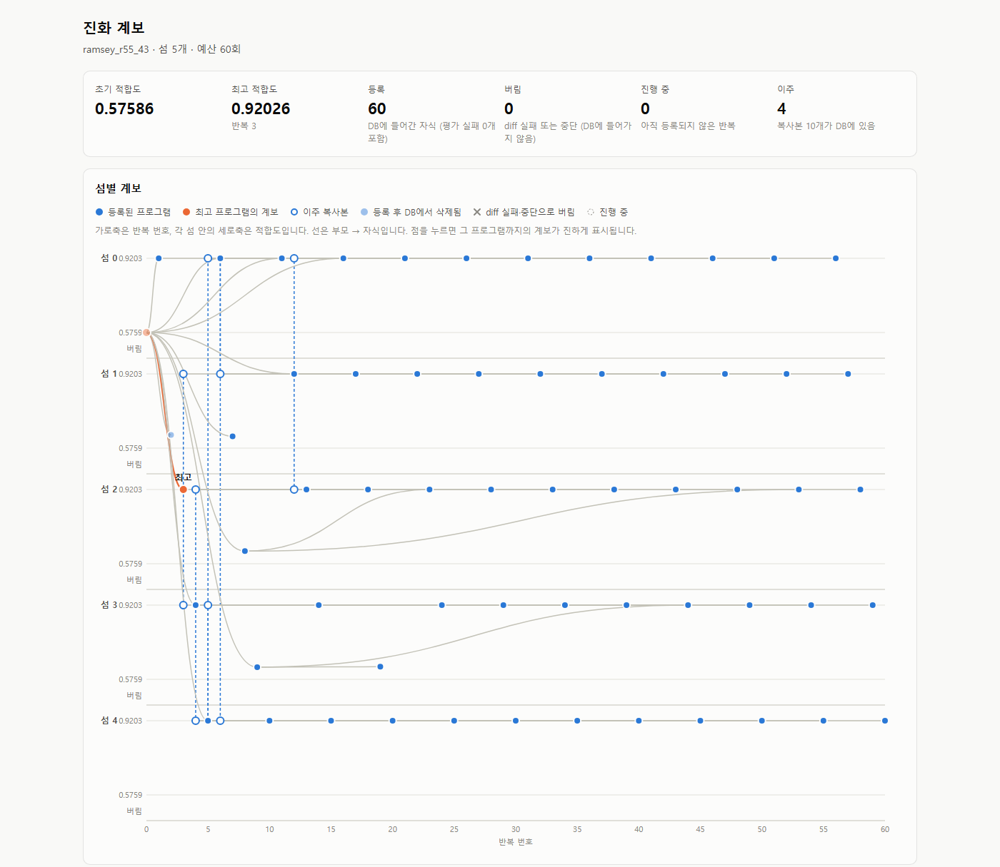

# BetaEvolve

**BetaEvolve**는 Google DeepMind의 AlphaEvolve를 **Claude Code 에이전트 방식**으로 구현한 프로젝트입니다.
LLM API를 호출하거나 API 키를 넣을 필요 없이, Claude Code 세션 하나 안에서 진화 루프 전체가 돌아갑니다.

- GitHub: [dongju923/BetaEvolve](https://github.com/dongju923/BetaEvolve)
- 참고 논문: [AlphaEvolve: A coding agent for scientific and algorithmic discovery](https://arxiv.org/abs/2506.13131) (Novikov et al., Google DeepMind, 2025)
- 참고 구현체: [OpenEvolve](https://github.com/algorithmicsuperintelligence/openevolve)



*`evolve.py visualize`로 만든 계보 화면입니다. 섬 5개, 60회 반복으로 램지 수 R(5,5) 하한 문제를 탐색한 run입니다. 섬마다 한 줄이고, 가로축은 반복 번호, 세로축은 적합도입니다. 주황색은 최고 프로그램의 조상 계보, 속이 빈 원은 이주 복사본, 점선은 이주입니다.*

# 1. 왜 만들었나
AlphaEvolve는 LLM이 코드를 조금씩 고치고, 평가기가 점수를 매기고, 좋은 프로그램을 DB에 쌓아 다음 수정의 재료로 쓰는 **진화 알고리즘 + LLM** 구조입니다.
오픈소스 구현체인 OpenEvolve는 이 구조를 잘 옮겨 두었지만, 코드 수정을 OpenAI 호환 API로 호출하기 때문에 API 키와 호출 비용이 필요합니다.

그래서 생각한 것이 **"LLM 호출 부분을 Claude Code 서브에이전트로 바꾸면 어떨까?"** 입니다.

- **알고리즘은 OpenEvolve와 같습니다.** 프로그램 DB, 프롬프트 템플릿, diff 형식을 OpenEvolve 방식 그대로 따릅니다.
- **LLM 호출을 Claude Code 에이전트로 바꿨습니다.** Claude Code 메인 세션이 컨트롤러가 되고, 서브에이전트들이 코드 수정안을 쓰는 LLM 앙상블 역할을 합니다.
- **추가로 구현했습니다.** AlphaEvolve 논문에는 있지만 OpenEvolve에는 없는 **메타 프롬프트 진화**를 넣었습니다.

# 2. 동작 방식

```
 Claude Code 메인 세션 (컨트롤러)                    Claude Code 서브에이전트 (LLM 워커)
 ─────────────────────────────────                    ──────────────────────────────────
 init      초기 프로그램 평가, DB 생성
 sample    섬, 부모(20/70/10), 참고 코드,
           모델(sonnet/opus)을 골라
           반복마다 prompt.md 작성             ──────▶  prompt.md 읽기
                                                       SEARCH/REPLACE diff 작성 (response.md)
                                                       submit: diff 적용, EVOLVE-BLOCK만
                                                               바뀌었는지 검사, 캐스케이드 평가
 register  자식을 섬 격자와 아카이브에 등록,   ◀──────  (끝나면 알림)
           섬 세대 증가, 때가 되면 이주
 ...예산을 다 쓸 때까지 워커 `parallel`개를 계속 돌림...
 best / visualize
```

역할은 두 가지로 나뉩니다.

- **컨트롤러 (메인 세션)**
  - 지금 대화하고 있는 Claude Code 세션입니다
  - 부모 프로그램과 참고 코드를 골라 프롬프트를 만들고(`sample`), 평가가 끝난 자식을 DB에 등록합니다(`register`)
  - 절차는 `alphaevolve` 스킬(`.claude/skills/alphaevolve/SKILL.md`)에 적혀 있습니다
- **워커 (서브에이전트 `evolve-worker`)**
  - 반복마다 새로 띄우는 서브에이전트입니다. 모델은 앙상블에서 확률로 고르며 기본은 `sonnet` 0.7, `opus` 0.3입니다
  - 자기 `prompt.md`만 읽고 SEARCH/REPLACE diff를 `response.md`에 쓴 뒤, `submit`으로 diff 적용과 평가까지 진행합니다

**DB에 쓰는 것은 컨트롤러뿐**이라는 점이 핵심입니다. 워커는 DB를 건드리지 않기 때문에 여러 워커를 동시에 돌려도 안전합니다.
또 워커는 채점기에 과적합하지 않도록 숨겨진 평가 코드를 열지 말라고 지시받습니다. 다만 이건 에이전트 지시문과 도구 목록(Read, Write, Bash)으로 지키는 약속이지 샌드박스는 아닙니다.

모든 명령은 `runs/<이름>/` 아래의 JSON만 읽고 쓰고, 명령이 끝날 때마다 상태가 저장됩니다. 그래서 세션이 끊겨도 이어서 돌릴 수 있습니다.

# 3. OpenEvolve에서 그대로 옮긴 것

## 프로그램 DB
- 섬(island)마다 **코드 길이**와 **다양성**을 축으로 하는 MAP-Elites 격자를 따로 둡니다
- 엘리트 아카이브는 모든 섬이 공유합니다
- 부모는 **탐색 20% / 활용 70% / 적합도 가중 10%** 로 뽑습니다
- 참고 코드는 섬 1등 → 상위 프로그램 → 근처 칸 → 무작위 순으로 채웁니다
- 섬은 고리 모양으로 이어져 있고, 이주할 때 상위 프로그램을 양옆 섬에 복사합니다
- 평가에 실패한 프로그램도 실패 점수로 저장해서 다른 프로그램과 똑같이 경쟁시킵니다

## 프롬프트와 diff
- OpenEvolve의 기본 프롬프트 템플릿을 수정 없이 가져왔습니다
- LLM에게는 `EVOLVE-BLOCK` 안의 코드만 보여줍니다
- 수정은 SEARCH/REPLACE diff로 받고, 블록 바깥을 바꾸면 거부합니다

## 캐스케이드 평가
- `evaluate()`를 단계마다 별도 프로세스에서 제한 시간 안에 실행합니다
- 부모의 실행 결과(`output_artifacts`)를 자식에게 `PARENT_OUTPUT`으로 넘겨줍니다. 그래서 탐색형 프로그램이 처음부터 다시 시작하지 않고 **부모가 찾은 해에서 이어서** 탐색할 수 있습니다

# 4. 메타 프롬프트 진화
AlphaEvolve 논문은 프롬프트의 지시문도 프로그램과 별도 DB에서 함께 진화시킨다고 설명하지만, 점수 방식이나 변이 주기는 공개하지 않았습니다. OpenEvolve에는 이 기능이 아예 없습니다.
그래서 이 부분은 직접 설계해서 구현했습니다.

1. **진화 대상**: 시스템 프롬프트의 `## Strategy Guidance` 구역 하나만 진화시킵니다. 문제 설명, 배경지식, 형식 규칙은 고정입니다
2. **집단**: 지침 $G_0, G_1, \dots$은 `runs/<이름>/prompts.json`에 저장됩니다
3. **뽑기 (UCB1)**: 워커에게 코드 수정을 맡길 때마다 아래 점수가 가장 높은 지침 하나를 고릅니다

   $$
   \text{score}(G_i) = \frac{s_i + 1}{n_i + 2} + c\sqrt{\frac{\ln(N + 1)}{n_i + 1}}
   $$

   - $s_i$: 그 지침으로 만든 자식 중 부모를 넘긴 수
   - $n_i$: 사용 횟수 (결과를 기다리는 것도 포함해서, 병렬 워커들이 한 지침에 몰리지 않게 함)
   - $N$: 전체 사용 횟수, $c$: 탐색 계수 (기본 1.0)
4. **보상**: 자식의 적합도가 부모보다 높으면 1, 아니면 0입니다. 동점, 평가 실패, diff 실패는 모두 0입니다
5. **변이**: 반복 결과가 `mutate_every`개(기본 10) 쌓일 때마다 컨트롤러가 워커 하나에게 새 지침 작성을 맡깁니다. 이 워커는 성적 1위 지침, 다른 상위 지침 최대 3개, 최근 코드 결과(사용한 지침, 적합도 변화, 변경 요약)를 보고 새 지침을 씁니다. 집단이 `population_size`(기본 8)를 넘으면 성적 최하위를 지웁니다
6. **예산**: 지침 작성은 반복 예산을 쓰지 않습니다. 예산 60회에 `mutate_every: 10`이면 결과 10, 20, 30, 40, 50개 시점에 새 지침을 만들어 $G_0$ ~ $G_5$가 됩니다

트리 없이 지침 전체를 팔(arm)로 두는 평면 밴딧이라서 구조가 단순하고, 지침 사이의 `parent_id`는 계보 기록용으로만 씁니다.

# 5. 예제: 램지 수 R(5,5) 하한
저장소에는 원 채우기(circle packing)와 램지 수 R(5,5) 두 가지 예제 문제가 들어 있습니다. 맨 위 계보 이미지가 램지 문제를 돌린 결과입니다.

- **문제**: 정점 43개 그래프에서 크기 5 클리크와 크기 5 독립집합(합쳐서 "단색 K5")의 개수를 최소화합니다. 0개인 그래프를 찾으면 R(5,5) ≥ 44가 증명되지만, 알려진 연구 결과로 보면 사실상 불가능한 목표라서 **최대한 줄이는 것**이 현실적인 목표입니다
- **점수**: $1 - \ln(1 + K) / \ln(2 + \binom{43}{5})$ ($K$ = 단색 K5 개수)
- **결과** (섬 5개, 60회 반복)
  - 초기 프로그램(순환 그래프): 단색 K5 **344개**, 적합도 0.57586
  - 최고 프로그램(3번째 반복): 단색 K5 **2개**, 적합도 0.92026

계보 그래프를 보면 3번째 반복에서 나온 최고 프로그램이 이주를 통해 모든 섬으로 퍼지는 과정도 확인할 수 있습니다.

# 6. 사용 방법

## 설치
```bash
git clone https://github.com/dongju923/BetaEvolve.git
cd BetaEvolve

conda create -n alphaevolve python=3.11 -y
conda activate alphaevolve
pip install -r requirements.txt

python -m pytest -q        # 테스트가 모두 통과해야 합니다
```

저장소에 특정 컴퓨터의 경로가 남지 않도록, 에이전트 파일에는 `<PYTHON>`(conda 환경의 Python 경로)과 `<PROJECT_DIR>`(저장소 절대 경로) 자리표시자를 써 두었습니다.
`.claude/skills/alphaevolve/SKILL.md`, `.claude/agents/evolve-worker.md`, `CLAUDE.md` 세 파일에서 내 경로로 바꾼 뒤, **저장소 폴더에서** Claude Code를 시작하면 됩니다.

```bash
cd BetaEvolve
claude
```

## Claude Code에서 쓰기
별도 명령을 외울 필요 없이 평소 말투로 요청하면 됩니다.

```text
problems/circle_packing/problem.yaml로 진화 시작해줘
```

그다음은 컨트롤러가 알아서 진행합니다.
1. `init`을 실행하고 초기 점수와 경고를 알려줍니다
2. 예산을 다 쓸 때까지 워커를 병렬로 계속 돌리며, 새 최고점이 나올 때마다 알려줍니다
3. 마지막에 최고 점수, `best_program.py` 경로, 계보 HTML 경로를 보고합니다

진행 확인이나 이어서 돌리기도 똑같이 말로 하면 됩니다.

```text
runs/circle_packing 상태 보여줘
세션이 끊겼어. runs/circle_packing 이어서 돌려줘
runs/circle_packing 30회 더 돌려줘
problems/circle_packing/problem.yaml에 메타 프롬프트 진화 켜고 새 run으로 시작해줘
```

내 문제를 가져오면 스킬이 `problem.yaml`과 초기 프로그램을 만들어 보여주고, 확인을 받은 뒤 시작합니다.

## 문제 정의하기
문제는 YAML 파일 하나와 초기 프로그램으로 정의합니다.

```yaml
name: circle_packing_10
problem: |
  단위 정사각형 안에 원 10개를 겹치지 않게 배치해 반지름의 합을 최대화하라.
  construct_packing(n)은 (x, y, r) 리스트를 반환한다. 점수(combined_score)는 반지름의 합이다.
initial_program: initial_program.py

knowledge:                    # 선택: 배경지식 (텍스트, .md, .txt, .pdf)
  - title: 출발점에 대한 메모
    text: 초기 프로그램은 같은 크기의 원을 격자로 놓는다 ...

run:
  iterations: 20              # 만들 자식 수
  parallel: 4                 # 동시에 돌릴 워커 수

meta_prompt:
  enabled: true               # 메타 프롬프트 진화 켜기
```

초기 프로그램은 LLM이 바꿀 수 있는 부분을 `EVOLVE-BLOCK`으로 감싸고, 채점 함수 `evaluate()`는 블록 **바깥**에 둡니다. 그래야 LLM이 채점기를 바꿀 수 없습니다.

```python
import math

# EVOLVE-BLOCK-START
def construct_packing(n):
    ...                      # 표시 사이의 코드만 LLM에게 보이고, LLM이 바꿀 수 있다
# EVOLVE-BLOCK-END


def evaluate():
    previous = globals().get("PARENT_OUTPUT")   # 부모의 output_artifacts (초기 프로그램은 None)
    circles = construct_packing(10)
    ...
    return {
        "scores_to_maximize": {"combined_score": total},   # 필수. 적합도 = combined_score
        "output_artifacts": {"circles": circles},          # 선택. LLM에게 보여줌
    }
```

# 7. OpenEvolve와 다른 점

| 항목 | BetaEvolve | OpenEvolve |
|---|---|---|
| LLM 호출 | Claude Code 서브에이전트, API 없음 | OpenAI 호환 API |
| 실행 방식 | 단계마다 짧은 명령, 끝날 때마다 상태를 JSON으로 저장 | 오래 도는 프로세스 하나 |
| 섬 선택 | 뽑을 때마다 섬을 돌아가며 선택 | 컨트롤러가 섬 배정 |
| 아카이브 크기 | 예산이 작으면 예산의 1/5로 줄임 | 설정값 그대로 |
| 부모 실행 결과 | 자식에게 `PARENT_OUTPUT`으로 전달 | 프롬프트에만 표시 |
| 메타 프롬프트 진화 | 구현함 | 없음 |
| 옮기지 않은 것 | 임베딩 기반 새로움 검사, LLM 피드백 채점, 사용자 정의 집단 전략 | 있음 |

# 8. 마무리
- API 키를 따로 넣지 않고 Claude Code 세션 안에서 AlphaEvolve 스타일의 진화 탐색을 돌릴 수 있다는 점이 가장 큰 장점입니다
- 생성된 프로그램은 별도 프로세스에서 **현재 사용자 권한으로** 실행됩니다. 프로세스를 분리한 것이지 샌드박스가 아니므로, 평가 코드를 믿을 수 있는 문제만 실행하는 것이 좋습니다
- 라이선스는 Apache License 2.0이고, OpenEvolve에서 옮기거나 복사한 부분은 해당 고지를 유지했습니다

자세한 설정값과 run 폴더 구조는 [GitHub README](https://github.com/dongju923/BetaEvolve)에 정리해 두었습니다.
