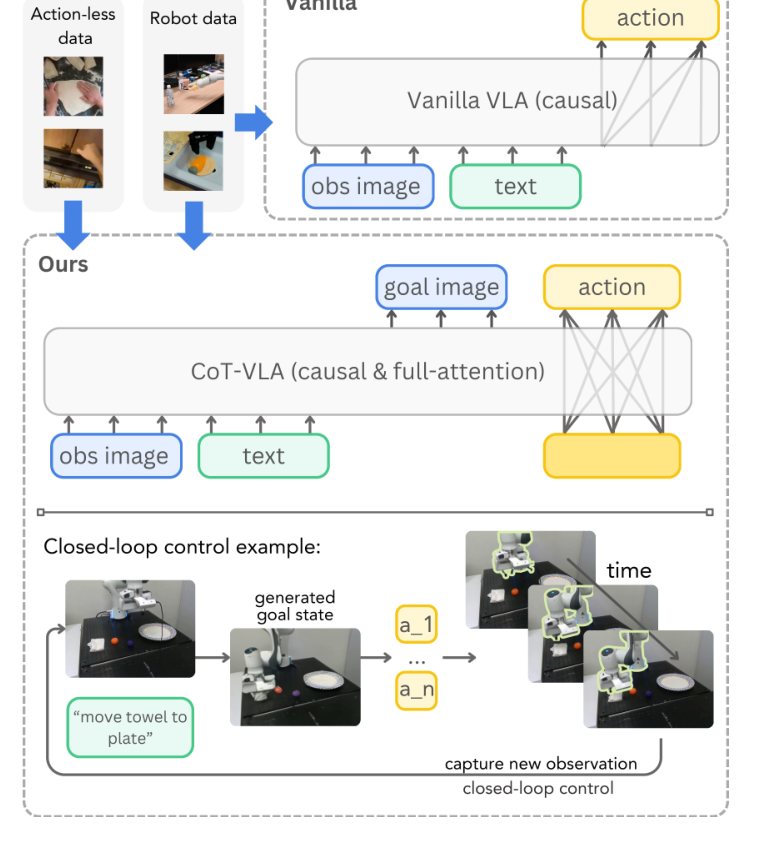
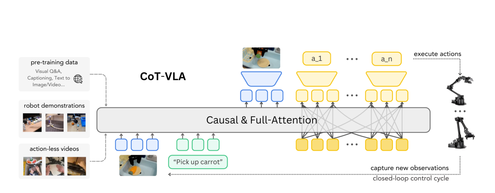
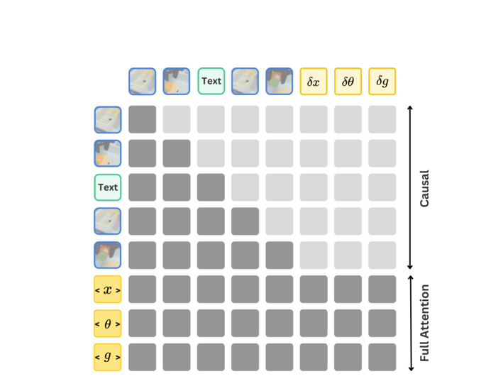
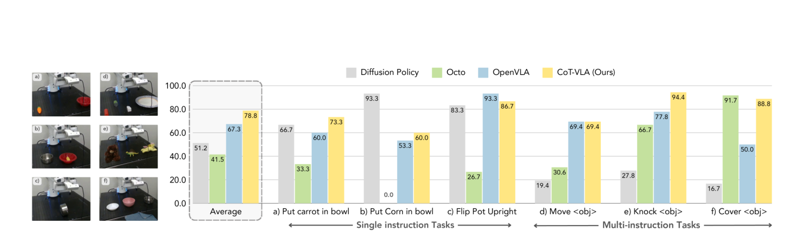
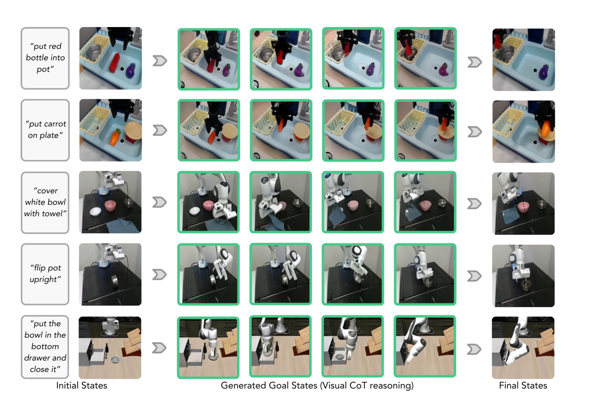
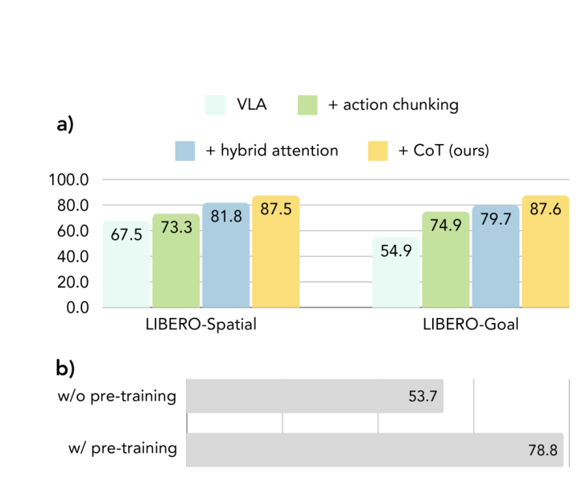

> 논문: [CoT-VLA: Visual Chain-of-Thought Reasoning for Vision-Language-Action Models](https://arxiv.org/abs/2503.22020) (CVPR 2025)  
> VLA 세미나 발표 자료를 정리한 글입니다. 행동 토큰화 방식은 [OpenVLA](/paper/vla/OpenVLA/)와 같고, 그 앞에 "목표 이미지 생성"이라는 추론 단계를 끼워 넣은 모델입니다.

**한 줄 요약**: LLM의 Chain-of-Thought에서 영감을 받아, VLA가 행동을 바로 내놓지 않고 먼저 **목표 이미지(subgoal image)를 생성**하게 해서 CoT 역할을 하게 한 논문. 목표 이미지를 생성하는 것 자체가 모델이 행동하기 전에 **시각적으로 생각하는 것**이라고 주장한다.

# Abstract
- VLA는 사전학습된 VLM과 다양한 로봇 시연을 활용해 일반화되는 로봇 제어를 학습할 수 있다
- 하지만 기존 VLA는 관측에서 행동으로 **바로 매핑**하기 때문에, 해석 가능성을 높이고 성능까지 올릴 수 있는 **명시적인 중간 추론 단계**가 없다. 그래서 시간적인 계획이나 추론 능력이 부족하다
- 이 논문은 행동을 바로 예측하는 대신, 먼저 로봇의 계획된 상태를 **픽셀 공간에서 나타내는 하위 목표 이미지**를 자기회귀적으로 생성하고, 현재 관측과 이 목표 이미지를 함께 보고 짧은 행동 시퀀스를 만드는 **Visual CoT**를 제안한다
- 이미지와 행동 토큰을 모두 이해하고 생성할 수 있는 7B VLA, **CoT-VLA**를 만들었다
- 최고 VLA 대비 실제 로봇 작업에서 **17%**, 시뮬레이션 벤치마크에서 **6%** 높은 성능을 냈다

> 17%, 6%는 상대 향상률이다. 아래 실험 결과로 계산하면 Franka-Tabletop 평균 67.3% → 78.8% (+11.5%p, 상대 17%), LIBERO 평균 76.5% → 81.1% (+4.6%p, 상대 6%)다.

# Introduction

- 언어 모델에서는 **Chain-of-Thought(CoT)** 프롬프팅이 단계별로 생각하게 해서 추론 능력을 크게 높였다
- 로봇에도 비슷한 시도가 있었다. 언어 설명, keypoint, bounding box 같은 **중간 표현**을 넣는 방식인데, 이런 표현은 장면을 추상화한 것이라 보통 별도의 전처리 파이프라인이 필요하다
- 이 논문은 **하위 목표 이미지**를 중간 추론 단계로 쓴다. 장점은 두 가지다
  1. 목표 이미지는 로봇 시연 데이터 안에 **이미 들어 있다**. 몇 프레임 뒤의 이미지를 가져오면 되므로 전처리가 거의 필요 없다
  2. 목표 이미지 생성에는 **행동 라벨이 필요 없다**. 그래서 행동 라벨이 없는 사람 영상 같은 풍부한 비디오 데이터로 시각적 추론을 학습할 수 있다
- Figure 1처럼 기존 VLA(위)는 행동 라벨이 있는 로봇 데이터만 쓰고 바로 행동을 예측한다. CoT-VLA(아래)는 EPIC-KITCHENS 같은 행동 없는 영상도 활용하고, 목표 이미지를 먼저 만든 뒤 그 목표를 이루는 짧은 행동 시퀀스를 만든다

**주요 기여**
1. 하위 목표 이미지 생성을 로봇 제어의 중간 추론 단계로 쓰는 **visual chain-of-thought** 방법 제안
2. 이미지·텍스트 생성에는 causal attention, 행동 예측에는 full attention을 쓰는 **hybrid attention** 을 적용한 CoT-VLA 시스템
3. 시뮬레이션과 실제 로봇에서 visual CoT가 VLA 성능을 높이고, 여러 로봇과 작업에서 최고 수준의 성능을 보임

# Method

## Visual Chain-of-Thought Reasoning
학습 데이터는 두 종류다.

**로봇 시연 데이터** $\mathcal{D}\_r$: 언어 지시 $l$, 행동 시퀀스, 이미지 관측 시퀀스로 이루어진다.

$$
\mathcal{D}_r = \left\{ \left(l,\ \mathbf{a}_{1 \dots T},\ \mathbf{s}_{1 \dots T}\right) \right\}
$$

**행동 없는 영상 데이터** $\mathcal{D}\_v$: 언어 설명과 이미지만 있고 행동 라벨은 없다.

$$
\mathcal{D}_v = \left\{ \left(l,\ \mathbf{s}_{1 \dots T}\right) \right\}
$$

**기존 VLA**는 사전학습된 VLM $P$를 $\mathcal{D}\_r$로 파인튜닝해서, 현재 관측 $\mathbf{s}\_t$와 지시 $l$에서 행동을 **바로** 예측한다.

$$
\hat{\mathbf{a}}_t \sim P_\theta\left(\mathbf{a}_t \mid \mathbf{s}_t, l\right) \tag{1}
$$

**CoT-VLA**는 행동을 만들기 전에 명시적인 시각적 추론을 넣어서 두 단계로 동작한다.

먼저 $n$ 프레임 뒤의 **하위 목표 이미지**를 예측한다 (시각적 추론 단계).

$$
\hat{\mathbf{s}}_{t+n} \sim P_\theta\left(\mathbf{s}_{t+n} \mid \mathbf{s}_t, l\right) \tag{2}
$$

그 다음 이 목표 상태에 도달하기 위한 **$m$개의 행동 시퀀스**를 만든다.

$$
\left\{ \hat{\mathbf{a}}_t, \dots, \hat{\mathbf{a}}_{t+m} \right\} \sim P_\theta\left( \left\{ \mathbf{a}_t, \dots, \mathbf{a}_{t+m} \right\} \mid \mathbf{s}_t, l, \hat{\mathbf{s}}_{t+n} \right) \tag{3}
$$

- 원하는 미래 상태를 먼저 명시적으로 그려보고 행동을 정하므로, 모델이 "시각적으로 생각"한 뒤 움직이는 셈이다
- 시각적 추론 단계(식 2)는 **로봇 시연 + 행동 없는 영상** 모두로 학습하고, 행동 생성 단계(식 3)는 **로봇 시연**으로만 학습한다

## Base Vision-Language Model: VILA-U
식 2처럼 이미지를 **생성**해야 하므로, 이미지와 텍스트를 모두 이해하고 생성할 수 있는 통합 멀티모달 모델 **VILA-U (7B)** 를 바탕으로 한다.
- 비디오, 이미지, 언어를 하나의 자기회귀 next-token prediction 틀로 다룬다
- 핵심은 **통합 vision tower**다. 시각 입력을 텍스트와 정렬된 **이산 토큰**으로 인코딩하기 때문에, 이미지와 영상도 텍스트처럼 자기회귀적으로 생성할 수 있다
- 이산 시각 특징의 표현력을 높이기 위해 **residual quantization**을 쓰고, RQ-VAE의 **depth transformer**로 잔차 토큰들을 차례로 예측한다
- 추출된 시각 특징은 projector를 거쳐 LLM 백본으로 들어간다
- 256×256 해상도 이미지 하나는 16×16 위치 × residual depth 4 = **16×16×4 토큰**으로 인코딩된다

## Hybrid Attention

- **이미지·텍스트 생성**: 일반 언어 모델처럼 **causal attention**으로 다음 토큰을 하나씩 예측한다
- **행동 생성**: **full attention**으로 모든 행동 토큰이 서로를 보면서 **한 번에** 예측한다. $[x]$, $[\theta]$, $[g]$는 행동을 병렬로 디코딩하기 위한 특수 토큰이다
- 기존 VLA(OpenVLA 등)는 행동 토큰도 causal하게 하나씩 만들었는데, CoT-VLA는 행동 차원끼리 서로 정보를 주고받게 한다

## Training Objective
**시각 토큰 예측**

학습 시퀀스는 $(l, \mathbf{s}\_t, \mathbf{s}\_{t+n})$ 형태다. VILA-U의 학습 목표를 그대로 따른다. 시각 토큰 위치 $j$마다, depth transformer $P_\delta$가 LLM이 만든 code embedding $h_j$를 바탕으로 $D$개의 잔차 토큰 $(k_{j1}, \dots, k_{jD})$를 자기회귀적으로 예측한다.

$$
\mathcal{L}_{\text{visual}} = -\sum_{j} \sum_{d=1}^{D} \log P_\delta\left(k_{jd} \mid k_{j,<d}\right) \tag{4}
$$

- $j$: 시각 토큰이 들어 있는 위치
- $D$: residual depth (여기서는 4). 한 위치의 이미지 정보를 4단계에 걸쳐 거칠게 → 세밀하게 표현한다

**행동 토큰 예측**

학습 시퀀스는 $(l, \mathbf{s}\_t, \mathbf{s}\_{t+n}, \mathbf{a}\_t, \dots, \mathbf{a}\_{t+m})$ 형태다.
- 행동 하나는 **7개 토큰**으로 표현되고, 각 행동 차원을 따로 이산화한다
- OpenVLA와 똑같이 각 차원을 **256개 구간**으로 나누는데, 구간 너비는 학습 데이터 행동 분포의 **1~99분위수** 사이를 균등하게 나눠서 정한다
- 텍스트 토크나이저 어휘에서 **가장 덜 쓰이는 256개 토큰**을 행동 구간 토큰으로 재활용한다
- 기존 VLA와 달리 행동 토큰에는 **full attention**을 쓴다

$$
\mathcal{L}_{\text{action}} = -\sum_{i=1}^{m} \log P_\theta\left(\mathbf{a}_t \dots \mathbf{a}_{t+m} \mid l, \mathbf{s}_t, \mathbf{s}_{t+n}\right) \tag{5}
$$

> 논문 식을 그대로 옮겼다. 합의 인덱스 $i$가 식 안에 나타나지 않는데, 행동 청크를 이루는 각 행동(행동마다 7개 토큰)에 대한 cross-entropy를 모두 더한다는 뜻으로 이해하면 된다.

**전체 학습 목표**: 행동 손실과 시각 손실을 더한다.

$$
\mathcal{L} = \mathcal{L}_{\text{action}} + \mathcal{L}_{\text{visual}} \tag{6}
$$

## Training Procedure
**사전학습 (Pretraining)**
- VILA-U 7B를 로봇 시연 $\mathcal{D}\_r$과 행동 없는 영상 $\mathcal{D}\_v$로 사전학습한다
- **LLM 백본, projector, depth transformer**를 학습하고 **vision tower는 고정**한다
- 로봇 시연: OpenVLA의 전처리를 따라 OpenX에서 3인칭 카메라가 있고 단일 팔 end-effector 제어(7자유도)를 쓰는 데이터셋을 골랐다
- 행동 없는 영상: **EPIC-KITCHENS-100**(주방에서의 사람 1인칭 영상)과 **Something-Something V2**(사람의 물체 조작 영상)
- 모든 이미지는 256×256으로 처리한다
- 목표 이미지의 미래 시점 $n$은 데이터셋마다 정한 범위 $[n_l, n_u]$에서 균등하게 뽑는다. 예를 들어 Bridge와 RT-1은 5~10프레임, TOTO는 20~24프레임, 사람 영상은 5~7프레임 뒤다
- 행동 청크 크기는 **10**

| 사전학습 하이퍼파라미터 | 값 |
| --- | --- |
| Learning rate | 1e-4 (cosine decay) |
| Global batch size | 2048 |
| Image resolution | 256×256 |
| Action chunk size | 10 |
| Epoch | 10 |

> Supplementary Table 5. 사전학습은 A100 96장(8장 × 12노드)으로 총 1.1만 A100-시간이 걸렸다.

**적응 (Adaptation)**
- 배포할 로봇에서 모은 작업별 시연 $\mathcal{D}\_r$로 파인튜닝한다. 사전학습과 똑같이 vision tower만 고정하고 나머지를 학습한다
- LIBERO와 Franka-Tabletop에서는 고정 학습률 1e-5로 150 에폭을 돌렸고, A100 노드 하나로 데이터 크기에 따라 10~24시간 걸렸다

## Test-time Closed-loop Control
배포 시에는 다음 과정을 반복하는 **폐루프 제어**를 한다.

1. 현재 관측 $\mathbf{s}^{obs}\_t$와 지시 $l$로 **목표 이미지를 생성**한다: $\hat{\mathbf{s}}\_{t+n} \sim P(\mathbf{s}\_{t+n} \mid l, \mathbf{s}^{obs}\_t)$
2. 현재 관측, 지시, 생성한 목표 이미지로 **행동 청크를 생성**한다: $[\hat{\mathbf{a}}\_t, \dots, \hat{\mathbf{a}}\_{t+m}]$
3. 행동 $m+1$개를 차례로 **실행**한다
4. $t \leftarrow t + m + 1$로 옮기고 **새 관측**을 받아서 1번으로 돌아간다

# Experiments
세 가지 질문에 답한다.
1. 여러 벤치마크와 로봇에서 최신 baseline과 비교하면 어떤가?
2. 사전학습, visual CoT, hybrid attention이 성능에 얼마나 영향을 주는가?
3. 시각적 추론이 좋아지면 행동 예측도 좋아지는가?

## Experimental Setup
- **LIBERO** (시뮬레이션): Spatial, Object, Goal, Long 4개 스위트 × 작업 10개 × 작업당 사람 원격조작 시연 50개. OpenVLA의 전처리를 따라 멈춘 구간 제거, 256×256 리사이즈, 이미지 180도 회전을 적용했다
- **Bridge-V2** (실제 로봇): 6자유도 WidowX 팔, 언어 라벨이 붙은 45,000개 trajectory. 사전학습에도 들어간 데이터지만, 학습 행동 예측 정확도가 95%에 도달할 때까지 Bridge-V2로만 추가 파인튜닝했다
- **Franka-Tabletop** (실제 로봇): 테이블에 고정된 7자유도 Franka 팔. **사전학습 때 보지 못한 셋업**이고, 작업당 10~150개의 적은 시연으로 새 환경 적응 능력을 본다

**비교 대상**
- **Diffusion Policy**: 최신 모방학습. 각 시나리오마다 처음부터 학습하고, 행동 청크와 고유 상태, DistilBERT 언어 임베딩을 쓴다
- **OpenVLA**: 사전학습 VLM을 OpenX로 파인튜닝한 오픈소스 VLA
- **Octo**: VLM 초기화 없이 OpenX로 사전학습한 범용 정책
- **SUSIE**: 지시문 기반 이미지 편집으로 목표 이미지를 만들고, 목표 조건부 정책으로 행동을 만드는 2단계 방식
- OpenVLA, Octo는 Bridge-V2에서 공개 체크포인트를 쓰고, LIBERO와 Franka-Tabletop에서는 파인튜닝했다

## Evaluation Results
**LIBERO**

| Method | Spatial | Object | Goal | Long | Average |
| --- | --- | --- | --- | --- | --- |
| Diffusion Policy | 78.3% | **92.5%** | 68.3% | 50.5% | 72.4% |
| Octo (fine-tuned) | 78.9% | 85.7% | 84.6% | 51.1% | 75.1% |
| OpenVLA (fine-tuned) | 84.7% | 88.4% | 79.2% | 53.7% | 76.5% |
| **CoT-VLA-7B** | **87.5%** | 91.6% | **87.6%** | **69.0%** | **81.1%** |

> Table 1. 스위트마다 시드 3개 × 500 에피소드

- CoT-VLA가 Object를 제외한 모든 스위트와 평균에서 가장 높다. 특히 긴 작업인 **Long에서 53.7% → 69.0%** 로 크게 오른다
- 실패 영상을 분석해보면, baseline들은 언어 지시를 무시하고 시각 단서에 과적합하는 경우가 있었다. 예를 들어 LIBERO-Spatial처럼 작업마다 초기 장면이 비슷하면, 지시와 다른 작업을 수행하기도 했다
- CoT-VLA는 언어에 근거한 목표 이미지를 먼저 생성하고 그 목표를 이룰 행동을 예측하기 때문에 지시를 더 잘 따른다

**Bridge-V2**

| Category | SUSIE | Octo | OpenVLA | CoT-VLA |
| --- | --- | --- | --- | --- |
| Visual | 30% | 35% | **75%** | 65% |
| Motion | 10% | 10% | 45% | **60%** |
| Semantic | 20% | 0% | 40% | **50%** |
| Language | 40% | 40% | **75%** | 70% |

> Table 2. 카테고리당 10회, 부분 점수 포함. Visual: 어지러운 환경에서 "가지를 냄비에 넣기", Motion: 높이를 바꾼 "당근을 접시에 놓기", Semantic: "보라색 포도를 냄비에서 꺼내기", Language: "가지 또는 빨간 병을 냄비에 넣기"

- SUSIE는 diffusion 사전지식 덕분에 목표 이미지의 화질은 더 좋지만, 새 물체나 복잡한 언어 grounding이 필요한 작업에서 성공률이 낮다
- OpenVLA보다 Visual과 Language에서 조금 낮은데, 시각적 추론이 틀려서가 아니라 **행동 청크 때문에 잡기에 실패**한 경우였다
- 그래도 네 카테고리 전체로 보면 baseline과 비슷하거나 더 좋다

**Franka-Tabletop**

- 적은 시연으로 파인튜닝하는 실험이다
- Diffusion Policy는 "옥수수를 그릇에 넣기" 같은 **단일 지시 작업**에서 가장 좋지만, 다양한 물체와 복잡한 언어 지시가 있는 **다중 지시 작업**에서는 성능이 떨어진다
- OpenX로 사전학습한 Octo, OpenVLA, CoT-VLA는 언어 grounding이 중요한 다중 지시 작업에 더 잘 적응한다
- CoT-VLA가 평균 **78.8%** 로 가장 높고(OpenVLA 67.3%), 단일·다중 지시 작업 모두에서 좋아진다

> Figure 5. 왼쪽은 지시문과 초기 상태, 가운데는 생성한 중간 목표 이미지(visual CoT), 오른쪽은 작업을 마친 최종 상태. 각 목표 이미지는 지시문과 가장 최근 관측을 보고 생성된다.

## Ablation Study

**Visual CoT, Hybrid Attention, Action Chunking** (LIBERO-Spatial, LIBERO-Goal)

같은 VILA-U 백본에 구성 요소를 하나씩 더하며 비교했다.

| 변형 | Spatial | Goal |
| --- | --- | --- |
| VLA (CoT·행동 청크 없음, OpenVLA 방식) | 67.5 | 54.9 |
| + action chunking | 73.3 | 74.9 |
| + hybrid attention | 81.8 | 79.7 |
| **+ CoT (ours)** | **87.5** | **87.6** |

- 행동을 하나씩 예측하는 것보다 **행동 시퀀스(청크)를 예측**하는 것이 일관되게 좋다
- **Hybrid attention**을 더하면 더 좋아진다
- **Visual CoT**까지 더한 완전한 CoT-VLA가 가장 좋다

**사전학습의 효과** (Franka-Tabletop)
- OpenX + 행동 없는 영상으로 사전학습한 CoT-VLA는, VILA-U를 Franka-Tabletop 시연으로 바로 파인튜닝한 것보다 **53.7% → 78.8%** (상대 46.7%) 좋다

## Better Visual Reasoning Helps
- 기존 VLA는 로봇 시연만 쓰지만, CoT-VLA는 중간 시각 추론 단계 덕분에 **행동 없는 영상**으로도 사전학습할 수 있다. 캡션이 달린 영상만으로 동역학과 지시 따르기를 배울 수 있고, 이런 영상은 로봇 시연보다 훨씬 많다
- 시각적 추론이 좋아지면 실제로 로봇 성능도 좋아지는지 보기 위해, Franka-Tabletop에서 처음 보는 하위 작업 두 개를 이어 붙인 긴 작업을 만들었다
  1. "초록 파를 사과 그림 책 위로 옮기기"
  2. "초록 콜리플라워를 곰 그림 책 위로 옮기기"
- 작업마다 시연 1개를 모아 정답 목표 이미지를 얻고, 각 5회씩 두 조건으로 평가했다

| 목표 이미지 | Sub-task 1 | Sub-task 2 |
| --- | --- | --- |
| CoT-VLA가 생성한 목표 이미지 | 20% | 0% |
| 정답(ground-truth) 목표 이미지 | **60%** | **40%** |

> Table 3

- 정답 목표 이미지를 주면 두 작업 모두 성공률이 **40%p** 오른다
- 목표 이미지 생성(시각적 추론)이 좋아지면 그대로 행동 성능 향상으로 이어질 수 있다는 뜻이다. 아직은 분포 밖 목표 이미지 생성이 약하지만, 대규모 영상·이미지 모델의 발전으로 좋아질 여지가 크다

# Conclusion, Limitations and Future Work
- 중간 목표 이미지를 명시적인 추론 단계로 넣어서 VLA에 chain-of-thought를 결합한 CoT-VLA를 제안했다
- bounding box나 keypoint 같은 추상적 표현 대신 **영상에서 뽑은 목표 이미지**를 해석 가능하고 효과적인 중간 표현으로 쓴다

**한계**
1. **추론이 느리다**: 행동 토큰을 만들기 전에 이미지 토큰 256개를 먼저 생성해야 해서, 행동 청크 크기가 10일 때 직접 행동을 생성하는 방식보다 평균 **7배 느리다**. 행동 청크와 병렬 디코딩으로 속도를 올렸지만 이미지 생성이 주된 병목이다. 빠른 이미지 생성이나 LLM 추론 가속 기법을 도입할 수 있다
2. **목표 이미지 화질**: 자기회귀 이미지 생성이라 최신 diffusion 기반 모델보다 화질이 낮다. 최근 통합 멀티모달 모델들이 개선 방향이 될 수 있다
3. **행동 청크의 한계**: 청크 사이에서 행동이 끊기듯 불연속적일 수 있고, 실행 중 고주파 피드백이 없다. 시간적 스무딩이나 Diffusion Policy 같은 스텝별 예측으로 보완할 수 있다
4. **새 작업으로의 시각적 추론 일반화**: 행동 없는 영상을 사전학습에 쓰지만, 현재 연산 한계로 완전히 새로운 작업까지 시각적 추론을 일반화하지는 못한다. 영상·이미지 생성 모델과 world model의 발전이 기회가 될 수 있다
