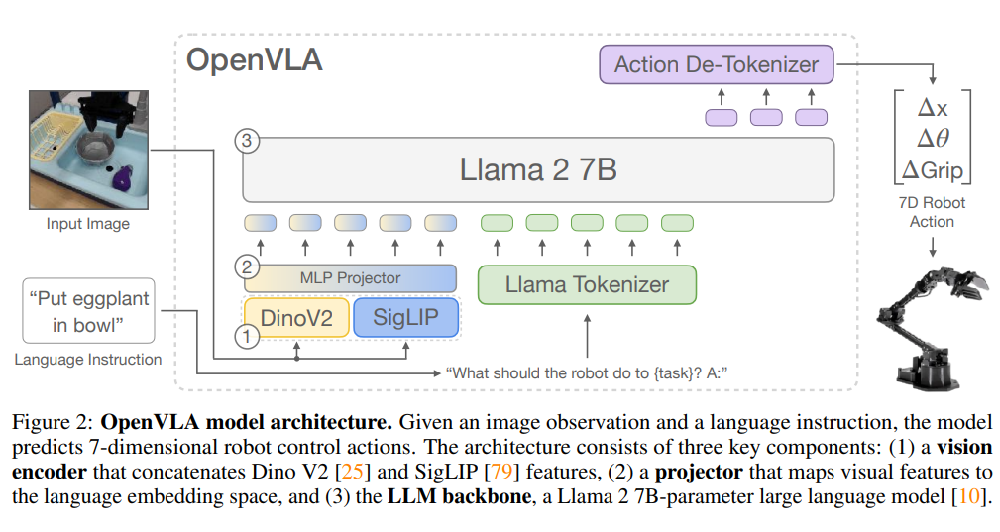
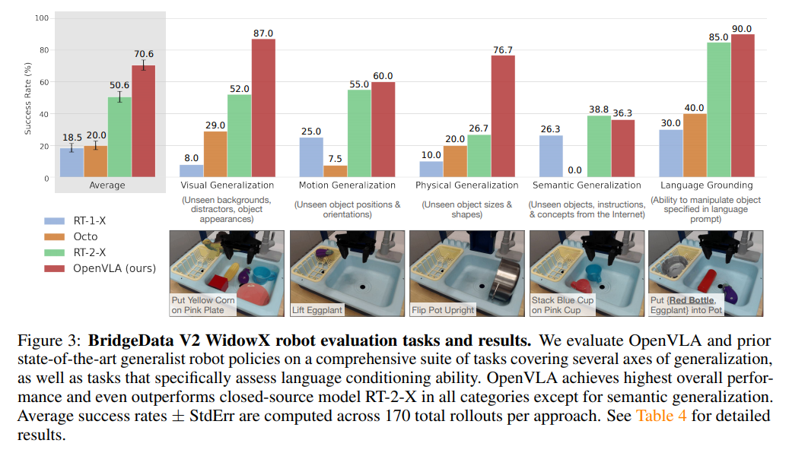
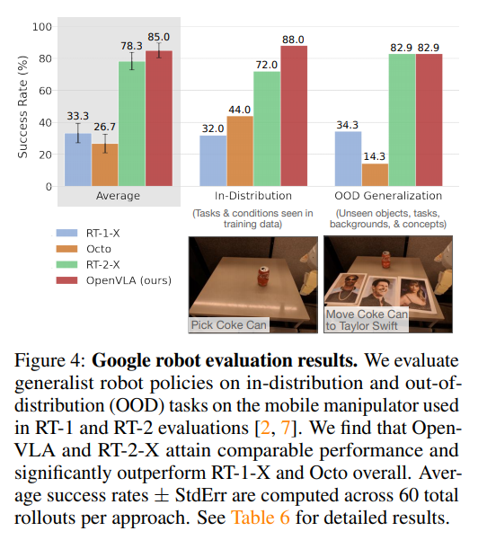
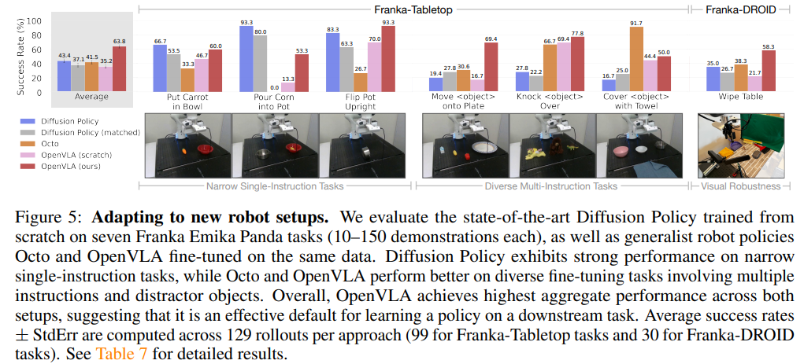
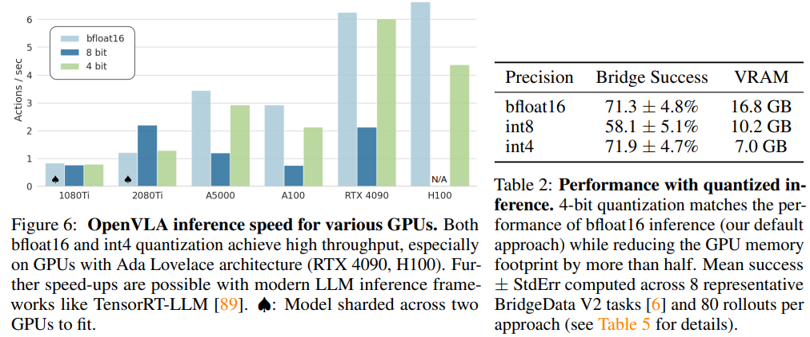

> 논문: [OpenVLA: An Open-Source Vision-Language-Action Model](https://arxiv.org/abs/2406.09246) (CoRL 2024)  
> VLA 세미나 발표 자료를 정리한 글입니다. 행동을 256개 구간으로 이산화해서 토큰으로 예측하는 방식은 [RT-1](/paper/RT-1/)에서 시작된 방식이고, 연속 행동을 flow matching으로 만드는 [π0](/paper/vla/pi0/)와 비교해서 보면 좋습니다.

# Abstract
- 기존에는 로봇에게 새 작업을 시키려면 그 작업의 시연 데이터를 모아 정책 모델을 처음부터 학습시켜야 했다. 데이터가 많이 필요하고, 학습한 환경과 조금만 달라져도 잘 안 되는 경우가 많다
- 인터넷 규모의 비전-언어 데이터와 다양한 로봇 시연으로 사전학습한 VLA를 파인튜닝하면 강건하고 일반화되는 정책을 얻을 수 있다. 하지만 두 가지 걸림돌이 있었다
  1. 기존 VLA는 대부분 **비공개**라 접근이 어렵다
  2. VLA를 새 작업에 **효율적으로 파인튜닝**하는 방법이 거의 연구되지 않았다
- 그래서 **97만 개**의 다양한 실제 로봇 시연으로 학습한 **7B** 파라미터 오픈소스 VLA, OpenVLA를 공개한다. Llama 2 언어 모델에 DINOv2와 SigLIP의 사전학습 특징을 합친 비전 인코더를 결합했다
- 데이터 다양성과 새 모델 구성 요소 덕분에, 29개 작업과 여러 로봇 형태에서 비공개 모델 **RT-2-X(55B)보다 절대 성공률이 16.5%p 높고**, 파라미터는 7배 적다
- 새 환경으로의 파인튜닝도 잘 되어서, 처음부터 학습하는 Diffusion Policy보다 20.4%p 높다
- **LoRA**로 일반 소비자용 GPU에서도 파인튜닝할 수 있고, **양자화**로 성공률 저하 없이 효율적으로 서빙할 수 있다
- 모델 체크포인트, 파인튜닝 노트북, PyTorch 학습 코드를 모두 공개했다

# Related Work
**VLM**
- 최근 오픈소스 VLM들은 사전학습된 ViT의 패치 특징을 토큰처럼 다루고 언어 모델 입력 공간으로 투영하는 단순한 "patch-as-token" 구조로 수렴했다. 덕분에 LLM 학습 도구를 그대로 쓸 수 있다
- OpenVLA는 다중 해상도 시각 특징으로 학습된 Prismatic VLM을 백본으로 쓴다. **DINOv2의 저수준 공간 정보**와 **SigLIP의 고수준 의미 정보**를 합쳐 시각적 일반화를 돕는다

**범용 로봇 정책**
- Octo 같은 기존 연구는 언어 임베딩이나 비전 인코더 같은 사전학습 부품에, **처음부터 학습하는 모델 부품**을 붙여서 정책 학습 중에 이어 붙이는 방식이다
- OpenVLA는 새로 붙이는 부품 없이, 로봇 행동을 **언어 모델 어휘의 토큰으로 취급**해서 VLM이 행동을 직접 생성하도록 end-to-end로 파인튜닝한다. 이 단순한 파이프라인이 확장성도 좋고 기존 범용 정책보다 성능도 뛰어났다

**VLA**
- 가장 가까운 연구는 RT-2-X(55B)다. OpenX 데이터셋으로 학습한 VLA로 당시 최고 성능이었다
- OpenVLA는 RT-2-X와 방식은 같지만 다음 점에서 다르다
  1. 강력한 오픈 VLM 백본과 **더 풍부한 로봇 사전학습 데이터**를 결합해서, 10배 가까이 작은 크기(7B)로 RT-2-X보다 좋은 성능을 낸다
  2. RT-2-X는 다루지 않은 **새 환경으로의 파인튜닝**을 자세히 조사한다
  3. **PEFT(LoRA)와 양자화**가 VLA에 효과적임을 처음 보였다
  4. 처음으로 **오픈소스**로 공개된 범용 VLA다

# The OpenVLA Model

**Prismatic-7B VLM 백본**

최근 VLM의 표준 구조대로 세 부분으로 이루어져 있다.
1. **비전 인코더 (600M)**: 입력 이미지 패치를 DINOv2와 SigLIP에 **각각** 통과시키고, 나온 특징 벡터를 **채널 방향으로 이어 붙인다**. CLIP이나 SigLIP만 쓰는 인코더보다, DINOv2 특징을 더하면 공간 추론 능력이 좋아져서 로봇 제어에 특히 도움이 된다
2. **프로젝터**: 작은 2층 MLP로, 시각 특징을 언어 임베딩 공간으로 보낸다
3. **LLM 백본**: Llama 2 7B

Prismatic은 이 부품들 위에 LLaVA 1.5 데이터(약 100만 개의 이미지-텍스트, 텍스트 샘플)로 파인튜닝된 VLM이다.

## Training Procedure
행동 예측 문제를 **"시각-언어" 과제**로 바꾼다. 입력(이미지 + 자연어 지시)을 받아서 언어 토큰 대신 **행동 토큰**을 출력하도록 학습하는 것으로, 다음 토큰 예측과 똑같이 학습한다. 출력하는 대상만 언어에서 행동으로 바꾼 셈이다. 프롬프트는 `"What should the robot do to {task}? A:"` 형태다.

**행동을 토큰으로 바꾸기**
- 로봇 행동의 각 차원을 **256개 구간(bin)** 으로 따로 이산화한다. 이 논문의 행동은 7차원(위치 변화 3, 회전 변화 3, 그리퍼 1)이라 $[0, 255]$ 범위의 정수 7개가 나온다
- 구간 범위는 최솟값~최댓값이 아니라 학습 데이터 행동의 **1분위수~99분위수**로 잡는다. RT-2처럼 최소~최대를 쓰면 데이터에 섞인 이상치 때문에 구간이 크게 넓어지고, 정작 정상 범위의 해상도가 떨어지기 때문이다

차원 $d$의 1분위수를 $q^{(d)}\_{1}$, 99분위수를 $q^{(d)}\_{99}$라 하면, 구간화는 다음과 같이 쓸 수 있다.

$$
b^{(d)} = \text{clip}\left( \left\lfloor \frac{a^{(d)} - q^{(d)}_{1}}{q^{(d)}_{99} - q^{(d)}_{1}} \times 256 \right\rfloor,\ 0,\ 255 \right), \qquad d = 1, \dots, 7
$$

> 논문은 "1분위수와 99분위수 사이를 균등하게 나눈다"고만 설명하므로, 위 식은 그 설명을 식으로 옮긴 것이다. 범위를 벗어나는 값은 양 끝 구간으로 들어간다.

- 256개의 새 토큰이 필요한데, Llama 토크나이저는 파인튜닝용 새 토큰 자리를 **100개**만 남겨두고 있어서 부족하다. 그래서 RT-2처럼 어휘에서 **가장 덜 쓰이는 마지막 256개 토큰을 행동 토큰으로 덮어쓴다**

**학습 목표**

일반 LLM처럼 다음 토큰 예측으로 학습하되, cross-entropy loss는 **행동 토큰에만** 계산한다. 이미지 $I$와 지시문 $\ell$이 주어졌을 때 7개 행동 토큰을 순서대로 예측하므로

$$
\mathcal{L} = - \sum_{d=1}^{7} \log p_\theta\left(b^{(d)} \;\middle|\; I, \ell, b^{(1)}, \dots, b^{(d-1)}\right)
$$

> 논문의 "standard next-token prediction objective, evaluating the cross-entropy loss on the predicted action tokens only"를 식으로 정리한 것이다.

## Training Data
목표는 다양한 로봇 형태, 장면, 작업을 폭넓게 담는 것이다. 그래야 여러 로봇을 바로 제어하고 새 로봇에도 효율적으로 파인튜닝할 수 있다.
- **Open X-Embodiment(OpenX)** 를 기반으로 학습 데이터를 선별했다. OpenX는 70개 이상의 로봇 데이터셋, 200만 개 이상의 trajectory를 커뮤니티 협업으로 일관된 형식에 모은 것이다
- 큐레이션의 목표는 두 가지다
  1. **입출력 공간 통일**: 3인칭 카메라가 최소 1대 있고, 관절 각도 대신 **단일 팔의 end-effector(손끝 위치·방향)를 제어**하는 조작 데이터셋만 남긴다
  2. **균형 잡힌 구성**: 첫 필터를 통과한 데이터셋에는 **Octo의 데이터 혼합 가중치**를 쓴다. 다양성이 낮은 데이터셋은 휴리스틱하게 가중치를 낮추거나 빼고, 작업·장면 다양성이 큰 데이터셋은 높인다
- Octo 이후 OpenX에 추가된 DROID 등의 데이터셋도 10%의 보수적인 가중치로 넣어봤지만, DROID의 행동 토큰 정확도가 학습 내내 낮게 유지됐다. 최종 모델 품질을 위해 **학습 마지막 3분의 1 구간에서는 DROID를 뺐다**
- 최종적으로 **97만 개** trajectory로 학습했다 (RT-2-X는 35만 개)

## Design Decisions
최종 학습 전에, 반복 속도를 높이고 비용을 줄이기 위해 전체 OpenX 대신 **BridgeData V2**로 소규모 실험을 해서 설계를 정했다.

**VLM 백본**
- Prismatic 외에 IDEFICS-1과 LLaVA도 파인튜닝해봤다
- 물체가 하나인 작업에서는 둘이 비슷했지만, 여러 물체 중 지시문이 말한 물체를 골라 조작해야 하는 작업에서는 LLaVA가 더 강했다 (언어 grounding 작업 5개 평균 +35%p)
- Prismatic은 단일 물체 작업과 다중 물체 작업 모두에서 LLaVA보다 성공률이 약 10%p 더 높았다. 논문은 이 차이를 SigLIP-DINOv2를 합친 백본의 향상된 공간 추론 능력 덕분으로 본다. 코드베이스가 모듈식이라 쓰기 쉬운 점도 선택 이유다

**이미지 해상도**
- 224×224와 384×384를 비교했는데 성능 차이는 없었고, 384는 학습이 3배 오래 걸렸다. 그래서 **224×224**를 택했다
- VLM 벤치마크에서는 해상도를 높이면 성능이 오르는 경우가 많지만, VLA에서는 (아직) 그런 경향이 보이지 않았다

**비전 인코더 파인튜닝**
- 기존 VLM 연구에서는 VLM 학습 중 비전 인코더를 **고정(freeze)** 하는 게 보통 더 좋았다. 인터넷 사전학습으로 얻은 강건한 특징을 지키기 때문이다
- 하지만 VLA 학습에서는 비전 인코더를 **파인튜닝하는 것이 성능에 결정적**이었다. 사전학습된 비전 백본이 정밀한 로봇 제어에 필요한 장면의 세밀한 공간 정보를 충분히 담지 못하기 때문으로 본다

**에폭과 학습률**
- 보통 LLM이나 VLM은 데이터를 1~2번만 돌지만, VLA는 훨씬 많이 반복하는 것이 중요했다. 학습 데이터의 행동 토큰 정확도가 95%를 넘을 때까지 실제 로봇 성능이 계속 올랐고, 최종적으로 **27 에폭**을 돌았다
- 학습률은 여러 자릿수에 걸쳐 탐색했고, VLM 사전학습 때와 같은 **2e-5 고정 학습률**이 가장 좋았다. warmup은 효과가 없었다

## Infrastructure
- 학습: **A100 64장으로 14일**(총 21,500 A100-시간), 배치 크기 2048
- 추론: bfloat16으로 **15GB** GPU 메모리를 쓰고, RTX 4090 한 장에서 컴파일이나 speculative decoding 같은 최적화 없이 약 **6Hz**로 동작한다
- 강력한 GPU가 로봇 옆에 없어도 되도록, 원격 추론 서버에서 행동을 실시간으로 스트리밍하는 기능도 공개했다

# Experiments
세 가지 질문에 답한다.
1. 여러 로봇과 여러 종류의 일반화에서 기존 범용 로봇 정책과 비교하면 어떤가?
2. 새 로봇과 작업에 효과적으로 파인튜닝할 수 있는가? 데이터 효율적인 최신 모방학습과 비교하면 어떤가?
3. PEFT와 양자화로 학습·추론 비용을 줄여서 더 쉽게 쓸 수 있는가? 성능-비용 trade-off는 어떤가?

## Direct Evaluations on Multiple Robot Platforms
추가 파인튜닝 없이 사전학습된 모델 그대로 두 로봇에서 평가했다.
- **WidowX** (BridgeData V2): 17개 작업 × 10회 = 170회
- **Google robot** (RT-1, RT-2 평가에 쓰인 모바일 매니퓰레이터): 12개 작업 × 5회 = 60회
- 일반화 축: 시각(처음 보는 배경, 방해 물체, 물체 색·외형), 동작(처음 보는 물체 위치·방향), 물리(처음 보는 물체 크기·모양), 의미(처음 보는 물체, 지시, 인터넷 개념), 그리고 여러 물체 중 지시한 물체를 고르는 언어 grounding
- 비교 대상: RT-1-X(35M), Octo(93M)는 OpenX 일부로 처음부터 학습한 Transformer 정책이고, RT-2-X(55B)는 인터넷 사전학습 백본을 쓴 비공개 VLA다

- RT-1-X와 Octo는 방해 물체가 있으면 엉뚱한 물체를 집거나, 팔을 목적 없이 휘젓기도 한다. 인터넷 사전학습이 없는 모델이라 이번 평가처럼 일반화를 크게 요구하면 성능이 낮은 것이 예상된 결과다
- **BridgeData V2**: OpenVLA가 평균 **70.6%** 로 RT-2-X(50.6%)보다 크게 높다. 의미적 일반화만 RT-2-X가 근소하게 높다(38.8 vs 36.3)
- **Google robot**: OpenVLA(85.0%)와 RT-2-X(78.3%)가 비슷하고, 둘 다 RT-1-X, Octo보다 훨씬 높다
- RT-2-X가 의미적 일반화에서 강한 이유는 더 큰 인터넷 사전학습 데이터를 쓰고, 로봇 데이터와 인터넷 데이터를 **함께 파인튜닝(co-fine-tuning)** 해서 사전학습 지식을 더 잘 보존하기 때문이다. OpenVLA는 로봇 데이터로만 파인튜닝했다
- 나머지 범주에서 OpenVLA가 비슷하거나 더 좋은 이유는 세 가지로 본다
  1. 학습 데이터가 훨씬 크다 (97만 vs 35만 trajectory)
  2. 데이터를 더 꼼꼼히 정제했다 (예: Bridge 데이터셋의 행동이 전부 0인 샘플 제거)
  3. 의미 특징과 공간 특징을 합친 비전 인코더를 쓴다

## Data-Efficient Adaptation to New Robot Setups
**평가 목적**: 새 로봇 환경에 적은 데이터로 파인튜닝했을 때 얼마나 잘 적응하는가?
- 사전학습된 범용 모델이 처음부터 학습하는 최신 모방학습(Diffusion Policy)보다 나은가?
- 대규모 로봇 사전학습(OpenX)이 실제로 적응에 도움이 되는가?

**평가 방법**
- **Franka-Tabletop**(테이블에 고정된 Franka 팔, 5Hz)과 **Franka-DROID**(DROID 데이터셋의 Franka 셋업, 15Hz)에서, 작업당 10~150개의 시연으로 파인튜닝한다
- 단일 지시의 좁은 작업과, 여러 물체와 여러 지시가 있는 다양한 작업을 모두 포함한다
- OpenVLA의 **모든 파라미터를 풀 파인튜닝**한다

**비교 대상**
- **Diffusion Policy**: 처음부터 학습하는 최신 데이터 효율적 모방학습. 관측 이력 2스텝, 고유 상태, 행동 청크를 쓴다
- **Diffusion Policy (matched)**: OpenVLA와 입출력을 맞춘 버전 (이미지 1장, 고유 상태·관측 이력·행동 청크 없음)
- **Octo**: 파인튜닝을 지원하는 범용 정책 중 최고. RT-2-X는 API로만 제공돼 파인튜닝할 수 없다
- **OpenVLA**: OpenX로 사전학습한 모델을 파인튜닝
- **OpenVLA (scratch)**: OpenX 사전학습 없이, 바탕이 되는 Prismatic VLM을 바로 새 로봇 데이터로 파인튜닝

- "당근을 그릇에 넣기", "옥수수를 냄비에 붓기" 같은 **좁은 단일 지시 작업**에서는 Diffusion Policy가 대등하거나 더 좋다
- **여러 물체와 다양한 언어 지시가 있는 작업**에서는 OpenX로 사전학습한 Octo와 OpenVLA가 더 좋다. OpenVLA (scratch)의 성능이 낮은 것을 보면, 언어 grounding이 중요한 작업에서 로봇 사전학습이 적응을 돕는다는 것을 알 수 있다
- 종합적으로 OpenVLA가 평균 **63.8%** 로 가장 높고, 테스트한 모든 작업에서 성공률 **50% 이상**을 낸 유일한 모델이다. 다른 방법들은 좁은 작업이나 다양한 작업 중 한쪽에서만 강하다
- 다만 좁지만 정교한 작업에서는 Diffusion Policy가 더 부드럽고 정밀한 궤적을 보인다. 행동 청크와 시간적 스무딩을 도입하는 것이 향후 과제다

## Parameter-Efficient Fine-Tuning
**평가 목적**: 앞의 풀 파인튜닝은 작업당 A100 8장으로 5~15시간이 걸렸다. 연산과 학습 파라미터를 훨씬 적게 쓰면서 성능을 유지하는 방법이 있는가?

**비교 전략**

| 전략 | 학습 대상 |
| --- | --- |
| Full FT | 모든 가중치 |
| Last layer only | Transformer 백본의 마지막 층 + 토큰 임베딩 행렬 |
| Frozen vision | 비전 인코더만 고정, 나머지 전부 학습 |
| Sandwich | 비전 인코더 + 토큰 임베딩 행렬 + 마지막 층 |
| LoRA ($r$ = 32, 64) | 모델의 모든 linear layer에 LoRA 적용 |

LoRA는 사전학습된 가중치 $W_0 \in \mathbb{R}^{d \times k}$는 고정하고, 작은 두 행렬의 곱으로 된 변화량만 학습한다.

$$
W = W_0 + \Delta W = W_0 + BA, \qquad B \in \mathbb{R}^{d \times r},\ A \in \mathbb{R}^{r \times k},\ r \ll \min(d, k)
$$

학습하는 파라미터가 $dk$개에서 $r(d + k)$개로 줄어든다.

**결과**

| 전략 | 성공률 | 학습 파라미터 | VRAM (배치 16) |
| --- | --- | --- | --- |
| Full FT | 69.7% | 7,188M | 163.3 GB (GPU 2장에 분산) |
| Last layer only | 30.3% | 465M | 51.4 GB |
| Frozen vision | 47.0% | 6,760M | 156.2 GB (GPU 2장에 분산) |
| Sandwich | 62.1% | 914M | 64.0 GB |
| **LoRA ($r$=32)** | **68.2%** | **98M** | **59.7 GB** |
| LoRA ($r$=64) | 68.2% | 195M | 60.5 GB |

> Table 1. Franka-Tabletop 일부 작업, 전략당 33회

- 마지막 층만 학습하거나 비전 인코더를 고정하면 성능이 크게 떨어진다. 새 장면에 맞게 **시각 특징을 계속 적응시키는 것이 중요**하다는 뜻이다
- Sandwich는 비전 인코더를 학습하므로 성능이 괜찮고, LLM 전체를 학습하지 않아서 메모리도 적게 쓴다
- **LoRA가 가장 좋은 trade-off**다. 전체 파라미터의 **1.4%** 만 학습하면서 풀 파인튜닝과 거의 같은 성능을 내고, A100 **한 장으로 10~15시간** 안에 새 작업에 파인튜닝할 수 있다 (풀 파인튜닝 대비 연산 8배 절감)
- LoRA rank는 성능에 거의 영향이 없어서 기본값 $r = 32$를 추천한다

> 5.3절(PEFT)과 5.4절(양자화) 실험은 최종 모델이 아니라, Octo와 같은 더 작은 데이터 혼합으로 사전학습하고 비전 인코더로 SigLIP만 쓰는 약간 작은 버전의 OpenVLA로 진행했다. 이 단순한 구조도 파인튜닝과 out-of-the-box 평가 모두에서 성능이 좋았다고 한다.

## Memory-Efficient Inference via Quantization
**평가 목적**: 7B 모델이라 1억 개 미만의 Octo보다 메모리를 많이 쓴다. 기본값인 bfloat16(메모리 절반, 16GB GPU로 서빙 가능)에서 더 나아가, LLM 서빙용 양자화로 메모리를 더 줄일 수 있는가?

**평가 방법**: 가중치를 bfloat16, int8, int4로 불러와서 BridgeData V2의 대표 작업 8개(작업당 10회)로 성공률과 VRAM을 측정하고, 여러 GPU에서 추론 속도를 쟀다.

| 정밀도 | 성공률 | VRAM |
| --- | --- | --- |
| bfloat16 | 71.3% | 16.8 GB |
| int8 | 58.1% | 10.2 GB |
| **int4** | **71.9%** | **7.0 GB** |

> Table 2

- **int4**는 bfloat16과 성능이 거의 같으면서 메모리는 **절반 이하**로 줄인다
- **int8**은 양자화 연산이 추가되는 오버헤드 때문에 대부분의 GPU에서 오히려 느려진다(2080Ti는 예외). 평가에 쓴 A5000에서 1.2Hz밖에 안 나와서, 5Hz 컨트롤러로 수집한 학습 데이터와 시스템 동작 특성이 크게 달라지고, 그 결과 성능이 떨어졌다
  - 오프라인으로 학습 데이터에 대한 토큰 정확도를 재보면 int8도 bfloat16과 비슷하다. 성능 하락은 양자화 자체가 아니라 **느린 추론 속도** 때문이다
- **int4**는 A5000에서 3Hz로 동작해서 데이터 수집 때의 동작 특성에 더 가깝다. GPU 메모리에서 읽어오는 양이 크게 줄어든 이득이 양자화 오버헤드보다 커서 int8보다 빠르다
- bfloat16과 int4 모두 RTX 4090, H100 같은 최신 GPU에서 처리량이 높고, TensorRT-LLM 같은 LLM 추론 프레임워크를 쓰면 더 빨라질 수 있다

# Discussion and Limitations
OpenVLA는 별도 조정 없이(out-of-the-box) 여러 로봇 형태에서 강력한 제어 성능을 보이는 최고 수준의 오픈소스 VLA이고, PEFT로 새 로봇 환경에도 쉽게 적응시킬 수 있다.

**한계**
1. **단일 이미지 관측만 지원**한다. 실제 로봇 환경은 센서 입력이 다양하다. 여러 장의 이미지, 로봇 고유 상태, 관측 이력까지 지원하도록 확장하는 것이 중요한 과제이고, 이미지와 텍스트가 섞인 데이터로 사전학습한 VLM이 도움이 될 수 있다
2. **추론 속도 개선**이 필요하다. 50Hz로 동작하는 ALOHA 같은 고주파 제어 환경과 더 정교한 양팔 작업에 VLA를 쓰려면 필수다. 행동 청크나 speculative decoding 같은 추론 최적화가 해결책이 될 수 있다
3. **성능 향상의 여지**가 있다. 기존 범용 정책보다 낫지만, 테스트한 작업에서 보통 성공률이 90% 미만이라 아직 신뢰성이 아주 높지는 않다
4. 연산 한계로 **설계 질문들이 충분히 탐구되지 않았다**. 기반 VLM의 크기가 성능에 어떤 영향을 주는지, 로봇 데이터와 인터넷 비전-언어 데이터를 함께 학습하면 성능이 크게 오르는지, VLA에 가장 맞는 시각 특징은 무엇인지 등은 커뮤니티가 함께 밝혀야 할 과제로 남겼다
