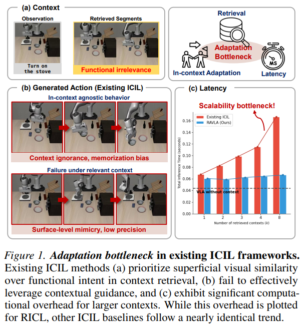
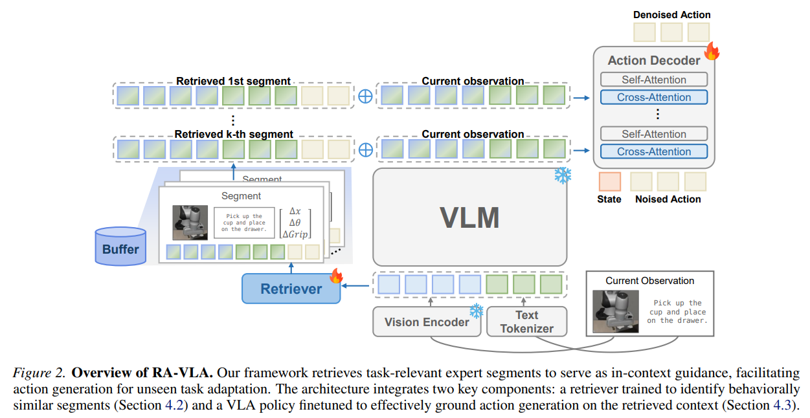
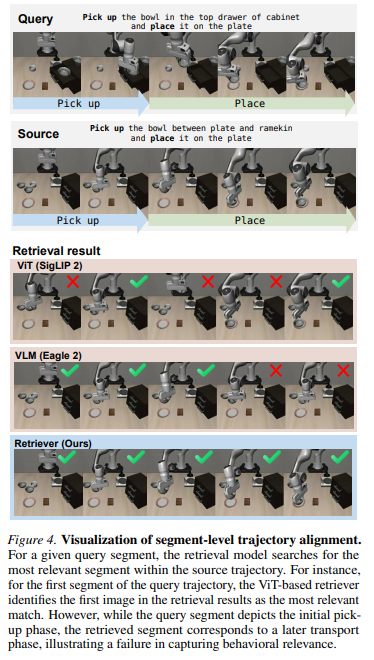
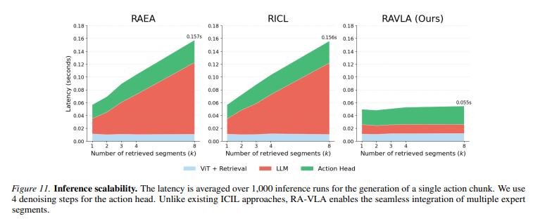

> 논문: [RA-VLA: Retrieval-Augmented VLA for Test-Time Adaptation](https://arxiv.org/abs/2608.25585) (ICML 2026)  
> VLA 세미나 발표 자료를 정리한 글입니다. VLA 기본 구조는 [RT-1](/paper/RT-1/) 글을 먼저 보고 오면 이해가 쉽습니다.

**한 줄 요약**: 로봇이 처음 보는 과업을 재학습 없이 수행할 수 있도록, 현재 상황과 **행동적으로** 비슷한 전문가 시연 구간을 검색하고, 모델이 그 구간을 실제로 참고하도록 학습시켜서, 추론 속도 저하 없이 새 과업 성공률을 높인 논문

# Abstract
- VLA는 범용 로봇 조작의 기반이 되지만, 처음 보는 과업 분포에서는 매우 취약하다
- **맥락 내 모방학습(ICIL, In-Context Imitation Learning)** 은 재학습이 필요 없는 대안이다. LLM의 in-context learning처럼 모델 가중치는 그대로 두고, 몇 개의 전문가 시연을 입력 맥락으로 주어서 새 과업에 적응시키는 방식이다
- 하지만 기존 ICIL은 **적응 병목(adaptation bottleneck)** 을 겪는데, 논문은 그 원인을 두 가지로 본다
  - **피상적인 검색**: 가스레인지를 켜야 하는데 겉모습이 비슷한 토스터 켜기 시연을 가져오는 경우
  - **행동 관성(behavioral inertia)**: 맞는 시연을 가져와도 제대로 참고하지 않고 사전학습 때의 습관대로 움직이는 경우
- 이를 해결하기 위해 **행동 정렬 기반 맥락 검색**과 **맥락에 근거한 실행 파이프라인**을 합친 검색 증강 VLA 프레임워크 RA-VLA를 제안한다
- 확장 가능한 구조 안에서 기능적 단서를 충실히 따르도록 강제해서, 추론 효율을 유지하면서 새 과업에 적응한다
- 기존 최고 baseline 대비 성공률이 LIBERO에서 **+17.60%p**, 실제 UR5e 환경에서 **+20.83%p** 향상

# Introduction

기존 ICIL의 한계는 Figure 1처럼 세 가지다.
1. **(a) 시각적 유사성만 보는 검색**: 기능적 의도보다 겉모습이 비슷한 구간을 가져온다
2. **(b) 행동 관성**: 맥락을 무시하고 사전학습 습관에 머무르거나, 맞는 맥락을 줘도 표면적으로만 따라 해서 정밀도가 낮다
3. **(c) 계산 부담**: 검색한 구간을 프롬프트에 붙이기 때문에 구간 수가 늘수록 지연시간이 크게 늘어난다

RA-VLA는 각각을 이렇게 해결한다.
- (a) → **행동 정렬 손실(behavioral alignment loss)**: 겉모습이 아니라 행동이 비슷한 구간끼리 가깝게 매핑되도록 검색기를 학습
- (b) → **맥락 준수 손실(contextual adherence loss)**: 관련 있는 시연과 무관한 시연을 줬을 때의 행동 예측 오차 차이에 마진을 강제해서, 정책이 맥락을 실제로 활용하게 만듦
- (c) → **확장 가능한 구조**: 각 구간을 독립적으로 미리 인코딩해 캐싱하므로, 구간 수가 늘어도 지연시간이 거의 늘지 않음

# Preliminaries
**Robotic manipulation**

매 시점 $t$에 정책 $\pi_\theta$는 시각 관측 $V_t$(고정 카메라, 손목 카메라 이미지), 언어 지시문 $L$, 로봇의 고유 상태(proprioceptive state) $s_t$를 받아서, 길이 $h$의 **행동 청크(action chunk)** 를 한 번에 예측한다. $h$는 행동 horizon, $c$는 행동 차원이다.

$$
A_t = [a_t, a_{t+1}, \dots, a_{t+h-1}] = \pi_\theta(V_t, L, s_t), \qquad A_t \in \mathbb{R}^{h \times c}
$$

정책은 behavioral cloning으로, 예측한 행동 청크와 전문가 시연의 행동 청크 차이를 줄이도록 학습한다.

**Flow-matching 기반 VLA**

RA-VLA는 GR00T N1.5 구조를 쓴다.
- VLM $f$가 이미지와 지시문을 인코딩해서 멀티모달 특징 $H_t = f(V_t, L)$를 만든다
- 행동 헤드 $g_\psi$는 Diffusion Transformer로, 노이즈에서 시작해 목표 행동 청크로 다듬어간다. 정답 벡터장 $F_t = A_t - A_t^{(0)}$을 회귀하도록 학습되고, 다음과 같이 노이즈가 섞인 행동 청크 $A_t^{(k)}$를 조금씩 업데이트한다

$$
A_t^{(k+\delta)} = A_t^{(k)} + \delta \cdot g_\psi\left(H_t, s_t, A_t^{(k)}, k\right)
$$

- $k \in [0, 1]$은 flow matching 진행도이고, $\delta$는 한 번에 이동하는 크기다. 논문은 디노이징 스텝을 4번 쓴다

# Method

## Overall Framework
목표는 버퍼 $\mathcal{B}$에 저장된 소수의 전문가 시연(**과업당 1~5개**)만으로, **가중치 업데이트 없이** 새 과업에 적응하는 것이다. 파이프라인은 **버퍼 구성 → 구간 검색 → 맥락 기반 행동 생성** 세 단계다.

> 학습과 평가에 쓰는 과업은 엄격히 분리한다. 여기서 "학습"은 VLA에 in-context 적응 능력을 길러주는 과정을 말하고, 평가 과업은 학습 때 한 번도 보지 않은 과업이다.

### 1. 버퍼 구성 (Context Buffer Construction)
- 긴 전문가 시연을 길이 $h$, 간격(stride) $s$의 슬라이딩 윈도우로 잘라 구간 $(V', L, s', A')$를 만든다. 논문 설정은 $h=16$, $s=4$
  - 구간 하나 = 시작 시점의 관측 이미지(3인칭 + 손목 카메라) + 지시문 + 그 시점의 로봇 상태 + 그 시점부터 16스텝 동안의 행동
  - 시작 지점을 4칸씩 옮기며 구간을 만든다. 예를 들어 128스텝짜리 시연 하나는 15개 구간이 된다
- 각 구간을 **독립적인 인코딩 단위**로 취급한다. 기존 방식처럼 프롬프트에 이어 붙이지 않기 때문에 입력 길이가 늘지 않는다
  - 기존 방식: `[현재 이미지 토큰 + 지시문 토큰 + 구간1 토큰 + 구간2 토큰 …]` → VLM. 구간을 많이 가져올수록 VLM이 처리할 토큰이 길어진다
  - RA-VLA: 현재 관측만 VLM에 넣고, 구간 정보는 VLM을 다시 거치지 않는다
- VLM $f$가 고정(frozen)되어 있으므로, 모든 구간의 특징 $H' = f(V', L)$을 **오프라인에서 미리 계산해 캐싱**해둘 수 있다
- 각 구간은 key-value 쌍으로 저장된다
  - **key** $z'$: 학습된 검색기 $R$이 구간을 요약한 임베딩 벡터
  - **value** $(H', s', A')$: VLM이 뽑은 구간 특징, 구간 시작 시점의 로봇 상태, 16스텝 행동. $s'$과 $A'$은 별도의 선형 인코더로 인코딩해서 쓴다

### 2. 구간 검색 (Expert Segment Retrieval)
- 쿼리는 현재 관측 $V_t$와 언어 지시문 $L$이다
- 검색기 $R$은 가벼운 **2층 Transformer 인코더**다(hidden 512, head 8). VLM 안의 LLM에 들어가기 직전의 입력 토큰(비전 인코더의 이미지 임베딩 + 텍스트 임베딩)을 그대로 받아 평균 풀링해서 임베딩 $z$를 만든다
- 버퍼의 키 $z'$들과 $z$의 코사인 유사도를 계산해서 상위 $K$개 구간의 value를 가져온다. 이것이 검색된 전문가 특징 집합이다

$$
\mathcal{H}_{ret} = \left\{ H_{ret}^{(1)}, \dots, H_{ret}^{(K)} \right\}
$$

- 검색 자체는 행렬곱 한 번과 Top-K라서 매우 빠르다. 버퍼에 구간이 $10^7$개 있어도 A100에서 0.18ms로, 전체 추론 시간의 0.36%에 불과하다

### 3. 맥락 기반 행동 생성 (Grounded Action Generation)
행동 헤드는 현재 관측 특징과 함께 검색된 전문가 구간을 참고해서 벡터장을 예측한다.

$$
F_t = g_\psi\left(H_t, \mathcal{H}_{ret}, s_t, A_t^{(k)}, k\right)
$$

- 로봇의 현재 상태 $s_t$와 노이즈가 섞인 행동 청크 $A_t^{(k)}$는 행동 헤드의 입력 시퀀스로 들어가고, 디노이징 진행도 $k$도 함께 주어진다
- 현재 관측 특징 $H_t$와 검색된 구간 특징은 행동 헤드의 **cross-attention**에 참고 자료로 들어간다

**Pairwise grounding**

전체 검색 결과를 모든 층에 한꺼번에 넣는 대신, **층마다 $H_t$와 구간 하나를 이어 붙여** cross-attention에 넣는다.

$$
H_t \oplus H_{ret}^{(i)}
$$

- 행동 헤드의 cross-attention 층은 8개이고, 현재 구현은 최대 $K=8$개 구간까지 지원한다
- 관련도가 높은 구간일수록 **위쪽 층**에 배정해서 세밀한 행동 보정에 쓰이게 한다. $K$가 층 수보다 적으면 구간을 여러 층에 반복해서 넣는다

| $K$ | 층별 구간 배정 (아래층 → 위층) |
| --- | --- |
| 1 | [1, 1, 1, 1, 1, 1, 1, 1] |
| 2 | [2, 2, 2, 2, 1, 1, 1, 1] |
| 3 | [3, 3, 2, 2, 2, 1, 1, 1] |
| 4 | [4, 4, 3, 3, 2, 2, 1, 1] |
| 8 | [8, 7, 6, 5, 4, 3, 2, 1] |

> Table 5 일부. 숫자는 관련도 순위(1 = 가장 관련 있는 구간)

- 이렇게 하면 검색된 맥락 전체를 활용하면서도 cross-attention 길이가 늘지 않아 연산량이 거의 그대로다
- 논문은 flow matching의 디노이징 스텝마다 배정을 바꾸는 식으로 확장할 수 있다고 언급한다. 스텝마다 다른 구간을 넣으면 (층 수 × 디노이징 스텝 수)만큼 더 많은 구간을 쓸 수 있다는 의미로 볼 수 있다

## 행동 인식 검색 학습 (Learning Action-Aware Retrieval)
검색이 단순한 시각적 유사성이 아니라 **행동적 관련성**을 잡도록, 검색 인코더 $R$을 위한 **행동 정렬 손실**을 제안한다.

**Positive 쌍 만들기 (Behavioral Pairs)**
1. 같은 과업의 전문가 시연 두 개를 무작위로 뽑는다 (LIBERO는 과업당 시연이 50개)
2. 시연은 $[(V_1, L, s_1, a_1), (V_2, L, s_2, a_2), \dots]$처럼 시점별로 이루어져 있는데, 여기서 **행동 시퀀스만** 가지고 **DTW(Dynamic Time Warping)** 로 두 시연의 시점을 짝짓는다
   - DTW는 길이나 속도가 다른 두 시퀀스를, 순서를 유지한 채 가장 잘 맞도록 짝지어주는 알고리즘이다. 여기서는 짝지은 행동들의 L2 거리 누적합이 최소가 되는 경로를 찾는다
   - 시간축으로 늘어나거나 위치가 조금 달라도 같은 동작 단계끼리 맞춰지므로, 짝지어진 구간들은 겉모습과 상관없이 행동적으로 대응된다
3. DTW 경로로 짝지어진 구간 쌍 $(i, j)$를 positive, 짝지어지지 않은 구간과 다른 과업의 구간을 negative로 쓴다

테스트 때는 행동 시퀀스를 알 수 없으므로, 검색기는 **관측(이미지 + 지시문)만으로** 이 행동 기반 정렬을 흉내 내도록 학습된다.

**Behavioral Alignment Loss**

짝지어진 시점의 이미지와 지시문을 검색기 $R$에 넣어 임베딩 $z$를 얻고, contrastive loss로 학습한다.

$$
\mathcal{L}_{align} = - \sum_{(i,j) \in \mathcal{P}} \log \frac{\exp\left(\text{sim}(z_i, z_j) / \tau\right)}{\sum_{k \in \{j\} \cup \mathcal{N}_i} \exp\left(\text{sim}(z_i, z_k) / \tau\right)}
$$

- $\text{sim}(\cdot, \cdot)$: 코사인 유사도, $\tau$: temperature (논문 설정 0.01)
- $\mathcal{P}$: DTW로 정렬된 positive 쌍의 집합
- $\mathcal{N}\_i$: 앵커 $i$의 negative 집합. 배치 안의 다른 구간들(DTW로 짝지어지지 않은 구간 + 다른 과업의 구간)
- log 안의 분수가 1에 가까워지도록 학습하면, $z_i$와 정답 $z_j$의 유사도는 높아지고 negative $z_k$들과의 유사도는 낮아진다
- 학습 과업에 국한되지 않는 근본적인 동작 패턴을 잡기 때문에, 처음 보는 과업에도 일반화된다

## 맥락 기반 행동 생성 학습 (Learning Context-Grounded Action Generation)
정책이 사전학습된 정보에 크게 의존하고 맥락을 무시하는 **행동 관성**을 깨기 위해 **맥락 준수 손실**을 도입한다. 행동 헤드가 검색된 구간을 근거로 예측하도록 유도하는 것이 목적이다.

매 학습 스텝마다 같은 정답 벡터장 $F_t$에 대해 두 가지 MSE를 계산한다.
- **관련 맥락 손실** $\mathcal{L}\_{rel}$: 검색기 $R$로 가져온 구간을 사용
- **무관 맥락 손실** $\mathcal{L}\_{irrel}$: 무작위로 뽑은 구간을 사용

$$
\mathcal{L}_{rel} = \left\| F_t - g_\psi\left(H_t, \mathcal{H}_{ret}, s_t, A_t^{(k)}, k\right) \right\|^2
$$

$$
\mathcal{L}_{irrel} = \left\| F_t - g_\psi\left(H_t, \mathcal{H}_{rand}, s_t, A_t^{(k)}, k\right) \right\|^2
$$

두 손실의 차이에 마진을 거는 것이 맥락 준수 손실이다.

$$
\mathcal{L}_{adhere} = \max\left(0,\ m - \left(\mathcal{L}_{irrel} - \mathcal{L}_{rel}\right)\right)
$$

- $m > 0$은 고정 마진이다 (논문 설정 0.01)
- 정책이 검색된 맥락을 무시하고 현재 관측만으로 행동을 예측하면, 어떤 구간을 넣든 예측이 같아서 $\mathcal{L}\_{rel}$과 $\mathcal{L}\_{irrel}$이 거의 같아진다. 그러면 차이가 마진 $m$을 넘지 못해 손실이 생긴다
- 반대로 관련 구간을 넣었을 때 오차($\mathcal{L}\_{rel}$)가 작고 무관한 구간을 넣었을 때 오차($\mathcal{L}\_{irrel}$)가 크면 손실이 0이 된다
- 즉 **맥락을 읽어야만 손실이 줄어드는** 학습 방식이다
- 이미 계산한 멀티모달 특징을 재사용하므로 학습 비용은 조금만 늘고, 추론 때는 추가 비용이 전혀 없다

최종 학습 목표는 행동 회귀 손실에 맥락 준수 손실을 더한 것이다.

$$
\mathcal{L}_{overall} = \mathcal{L}_{rel} + \lambda\, \mathcal{L}_{adhere}
$$

- $\lambda$는 두 손실의 비중을 조절하는 하이퍼파라미터 (논문 설정 0.1)
- 처음에는 $\mathcal{L}\_{irrel} / \mathcal{L}\_{rel}$ 비율에 마진을 거는 방식도 시도했지만, 학습이 수렴해서 MSE 값 자체가 0에 가까워지면 비율이 불안정해져서 차이 기반 마진을 택했다

**Remark: 출발점을 전문가 행동으로**
- 일반적인 flow matching은 출발점 $A_t^{(0)}$을 표준 정규분포에서 샘플링한다. 정답이 어디 있는지 모르는 상태에서 4번의 디노이징 만에 정답 행동까지 가야 한다
- RA-VLA는 검색된 전문가 구간들의 행동 $A'$을 **평균낸 행동 청크**를 출발점 $A_t^{(0)}$으로 쓴다. 정답 행동 근처에서 출발하는 셈이라 학습이 빨리 수렴하고, 처음 보는 과업에서 디노이징이 안정적이다

# Experiments
## Experimental Setup
**환경**
- **LIBERO** (시뮬레이션): 4개 스위트(Spatial, Object, Goal, Long) × 과업 10개 × 과업당 시연 50개
  - 4개 스위트 중 3개로 학습하고, 남은 1개를 완전히 처음 보는 도메인으로 평가
  - 평가 과업마다 시연 3개를 버퍼에 넣고, 50회 평균 성공률을 측정
- **UR5e** (실제 로봇): Stack Box, Throw Trash, Close Drawer, Press Pedal 4개 과업. 과업당 30개 시연을 GELLO 원격조작으로 수집
  - 4개 중 3개 과업으로 학습(LIBERO 데이터도 함께 사용)하고 1개로 평가하는 leave-one-out 방식
  - 시연 4개를 버퍼에 넣고, 과업당 12회 성공률을 측정

**비교 대상** (모두 GR00T N1.5 기반, 기본 $K=1$)
- **Vanilla VLA**: 학습 과업으로만 학습하고 시연 없이 사용
- **RAEA**: 검색한 구간을 멀티모달 프롬프트에 직접 이어 붙임
- **RICL**: 정책의 생성 결과와 검색된 전문가 행동을 거리 기반 가중치로 섞음. 가중치가 생성 결과 쪽이면 RICL_G, 검색 행동 쪽이면 RICL_R

RICL의 최종 행동은 다음과 같다. $d$는 검색 공간에서 쿼리와 가장 가까운 구간 사이의 L2 거리다.

$$
A_t = w(d) \cdot A' + \left(1 - w(d)\right) \cdot \pi_\theta(V_t, L, \mathcal{D}_{ret}), \qquad w(d) = e^{-wd}
$$

> RICL_G는 $w = 1.0$, RICL_R은 $w = 0.2$

## Novel Task Adaptation
**시뮬레이션 (LIBERO)**

| Retriever | Method | Spatial | Object | Goal | Long | Average |
| --- | --- | --- | --- | --- | --- | --- |
| - | Vanilla VLA | 0.000 | 0.066 | 0.002 | 0.000 | 0.0170 |
| Off-the-shelf (SigLIP 2) | RAEA | 0.060 | 0.106 | 0.008 | 0.006 | 0.0450 |
| | RICL_G | 0.092 | 0.156 | 0.106 | 0.000 | 0.0885 |
| | RICL_R | 0.048 | 0.052 | 0.086 | 0.000 | 0.0465 |
| Action-aware (Ours) | RAEA | 0.164 | 0.182 | 0.104 | 0.044 | 0.1235 |
| | RICL_G | 0.156 | 0.198 | 0.116 | 0.048 | 0.1295 |
| | RICL_R | 0.210 | 0.326 | 0.206 | 0.092 | 0.2085 |
| | **RA-VLA** | **0.320** | **0.556** | **0.532** | **0.130** | **0.3845** |

> Table 1. 처음 보는 스위트에서의 성공률

- Vanilla VLA는 새 과업에서 성공률이 거의 0이다
- 기성 검색기(SigLIP 2)를 쓴 ICIL은 조금 나아지지만, 행동적으로 무관한 구간을 자주 가져와서 한계가 있다
- **검색기만 제안 검색기로 바꿔도** 모든 baseline이 좋아진다: RICL_G 약 1.5배, RAEA 약 2.7배, RICL_R 약 4.5배
- 같은 검색기를 쓰는 조건에서도 RA-VLA가 모든 스위트에서 가장 높고, 평균 성공률이 최고 baseline(RICL_R)의 20.9%에서 **38.5%** 로 **+17.6%p** 오른다

**실제 로봇 (UR5e)**

| Method | Stack Box (Pick / Success) | Throw Trash (Pick / Success) | Close Drawer (Touch / Success) | Press Pedal (Touch / Success) | Average |
| --- | --- | --- | --- | --- | --- |
| Vanilla VLA | 0.000 / 0.000 | 0.083 / 0.000 | 0.500 / 0.333 | 0.000 / 0.000 | 0.0833 |
| RAEA | 0.000 / 0.000 | 0.250 / 0.000 | 0.667 / 0.500 | 0.000 / 0.000 | 0.1250 |
| RICL_R | 0.583 / 0.250 | 0.833 / 0.250 | 0.667 / 0.583 | **0.667** / 0.333 | 0.3542 |
| **RA-VLA** | **0.750 / 0.417** | **0.917 / 0.750** | **0.750 / 0.667** | 0.583 / **0.417** | **0.5625** |

> Table 2. 앞의 값은 중간 목표(집기, 닿기) 성공률, 뒤의 값은 최종 성공률. 모든 방법에 제안 검색기를 사용

- RA-VLA의 평균 성공률이 35.4%에서 **56.3%** 로 가장 높다 (+20.83%p)
- Stack Box 과업에서 RAEA는 작은 상자 대신 쓰레기를 집고(사전학습 습관을 따름), RICL_R은 상자를 들어 올리지만 목표 위치로 정확히 옮기지 못한다. 단순히 행동을 섞는 방식은 동작이 부정확하고 떨리기 때문이다

## Contextual Sensitivity Analysis
모델이 검색된 전문가 구간을 실제로 참고해서 행동을 만드는지(행동 관성이 있는지) 확인하는 실험이다. 검색된 구간 $\mathcal{D}\_{ret}$를 무작위 구간 $\mathcal{D}\_{rand}$로 바꿨을 때 예측 행동이 상대적으로 얼마나 바뀌는지를 **상대적 맥락 민감도** $S_{ctx}$로 측정한다.

$$
S_{ctx} = \frac{\left\| \pi_\theta(V_t, L, \mathcal{D}_{ret}) - \pi_\theta(V_t, L, \mathcal{D}_{rand}) \right\|}{\left\| \pi_\theta(V_t, L, \mathcal{D}_{ret}) \right\|}
$$

| Method | $S_{ctx}$ | LIBERO-Goal |
| --- | --- | --- |
| RAEA | 0.0247 | 0.104 |
| RICL_R | 0.0788 | 0.206 |
| RA-VLA w/o $\mathcal{L}\_{adhere}$ | 0.0353 | 0.098 |
| **RA-VLA** | **0.3639** | **0.532** |

> Table 3. 1,000개 샘플 평균

- 값이 클수록 맥락을 많이 활용한다는 뜻이다
- 기존 방법들은 $S_{ctx}$가 매우 낮다. 구간을 바꿔도 예측이 거의 안 바뀌므로 맥락을 거의 무시한다는 의미다. 학습 분포 안에서는 현재 관측만으로도 회귀 손실을 충분히 줄일 수 있어서, 일반적인 behavior cloning으로는 맥락을 쓸 이유가 없기 때문이다
- RA-VLA는 기존 방법의 약 5~15배로, 맥락을 실제로 활용한다
- 맥락 준수 손실을 빼면 $S_{ctx}$와 성공률이 함께 급감한다 → 맥락 준수 손실이 핵심

## Retriever Analysis

- 검색기가 겉모습이 아니라 행동이 비슷한 구간을 찾는지 확인하는 실험이다
- "집기 → 놓기"로 이루어진 서로 다른 시연 두 개를 두고, 한쪽(Query)의 각 구간마다 다른 쪽(Source)에서 가장 비슷한 구간을 찾게 한다
- 기성 파운데이션 모델과 비교했다
  - **SigLIP 2**: 여러 구간에서 틀린 동작 단계를 가져온다 (예: 집기 구간인데 옮기기 구간을 검색)
  - **Eagle 2**: 앞부분은 맞히지만 뒷부분에서 틀린다
  - **제안 검색기**: 모든 구간을 같은 동작 단계끼리 맞게 매칭한다
- 검색기를 기성 검색기에서 제안 검색기로 바꾸면, RA-VLA의 LIBERO-Goal 성공률이 **10.2% → 53.2%** 로 오른다

## Inference Scalability Analysis

- 로봇은 실시간으로 제어해야 해서 지연시간이 중요하다. 검색하는 구간 수 $K$를 1~8로 늘리며, 행동 청크 하나를 만드는 시간을 1,000회 평균으로 측정했다 (디노이징 4스텝)
- **RAEA, RICL**: $K$가 늘수록 지연이 가파르게 증가해서 $K=8$에서 약 0.156~0.157초. 구성 요소별로 보면 구간을 프롬프트에 이어 붙이느라 **LLM 부분**이 $K$에 따라 크게 늘어난다
- **RA-VLA**: $K$와 상관없이 거의 일정하고, $K=8$에서도 약 **0.055초**. 각 구간을 독립 단위로 미리 인코딩해두기 때문이다

## Analysis of Buffer and Retrieval Size
버퍼에 넣는 시연 수 $N$과 한 번에 검색하는 구간 수 $K$를 각각 1~4로 바꾸며 LIBERO-Goal 평균 성공률을 측정했다.

| | 1 | 2 | 3 | 4 |
| --- | --- | --- | --- | --- |
| $N$ (버퍼 시연 수) | 0.482 | 0.518 | 0.532 | 0.552 |
| $K$ (검색 구간 수) | 0.532 | 0.540 | 0.548 | 0.546 |

> Table 4

- $N$은 늘릴수록 꾸준히 좋아진다. 버퍼가 크면 후보 구간이 많아져서 현재 상황과 행동적으로 더 잘 맞는 구간을 찾을 수 있다. 즉 시연을 더 모을수록 성능이 오른다
- $K$는 늘려도 최대 1.6%p 차이로 거의 그대로다. 현재 실험 과업에서는 잘 맞는 구간 하나로도 필요한 단서가 충분하다는 뜻이다. 다만 더 복잡하거나 모호한 과업에서는 $K$를 늘리는 것이 유용할 수 있다고 본다

# Limitations
- 버퍼가 새 과업에 대한 유일한 가이드라서, 버퍼에 있는 시연의 질과 다양성이 적응 성능을 좌우한다
- 절대 성공률은 학습 분포 안의 성능에 비하면 여전히 낮고, 분포 밖 평가라서 하이퍼파라미터에 민감하다
- 대규모 학습, flow matching이 아닌 구조, 더 복잡한 조작 과업 등에서 추가 검증이 필요하다. 학습 규모가 커지면 구간을 독립적으로 인코딩하는 방식이 오히려 성능을 제한할 수도 있다
