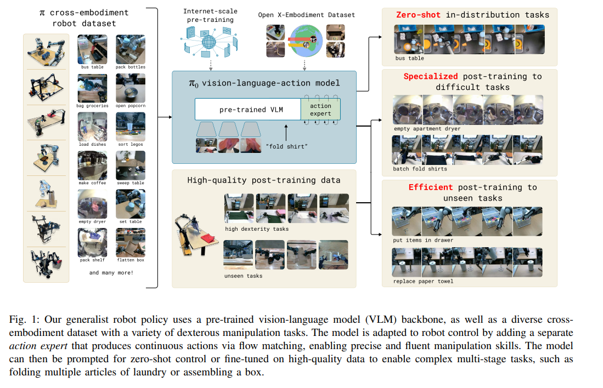
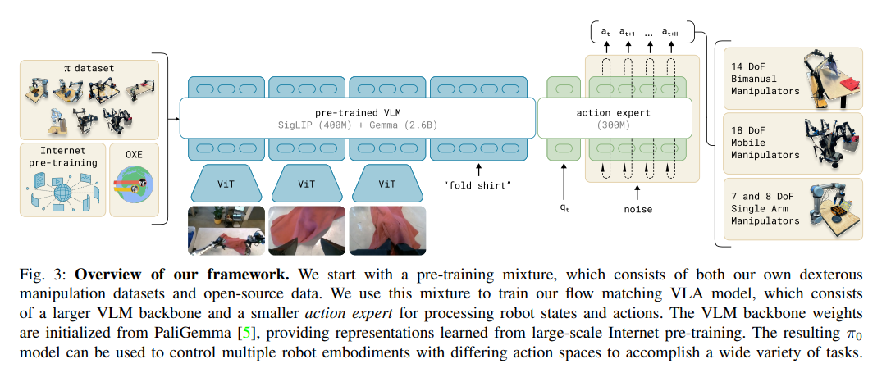
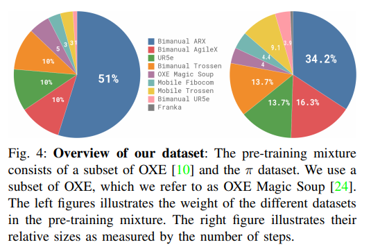
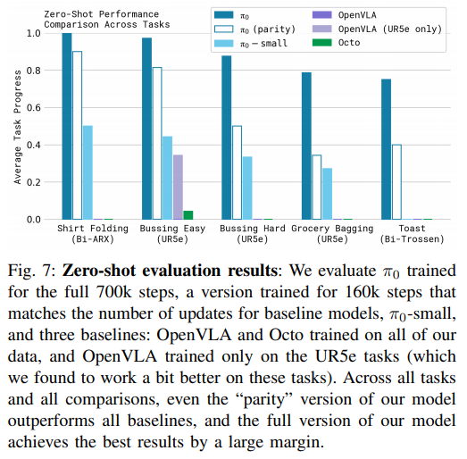
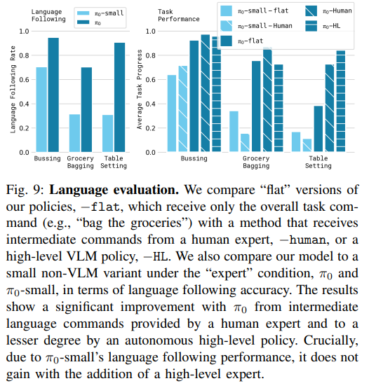
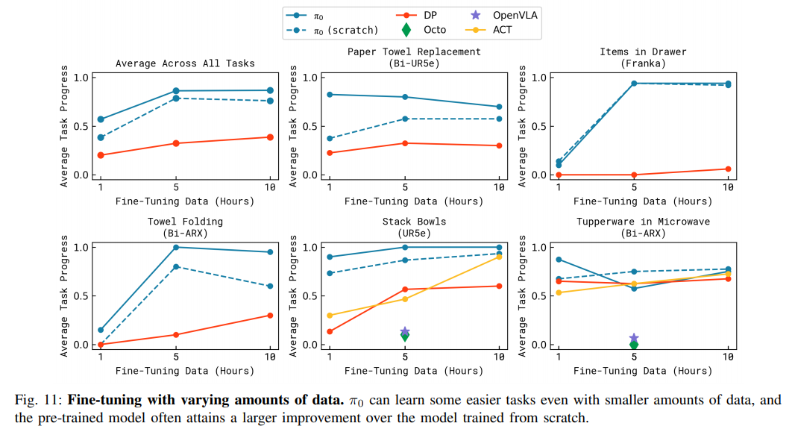
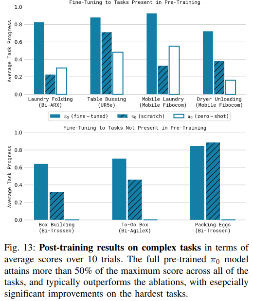

> 논문: [π0: A Vision-Language-Action Flow Model for General Robot Control](https://arxiv.org/abs/2410.24164) (Physical Intelligence, 2024)  
> VLA 세미나 발표 자료를 정리한 글입니다. 사전학습된 VLM에 flow matching 기반 행동 전문가(action expert)를 붙인 범용 로봇 정책입니다. 행동을 토큰으로 이산화하는 방식은 [RT-1](/paper/RT-1/) 글을 참고하세요.

# Flow Matching 원리
π0의 핵심인 flow matching을 먼저 직관적으로 정리한다. 목표는 **아무 노이즈나 넣으면 그럴듯한 행동으로 바꿔주는 장치**를 만드는 것이다.

**왜 속도(벡터장)를 배우는가?**
- 강물에 비유하면, 강 어디에 종이배를 띄우든 물살만 따라가면 하류에 도착한다
- 이 강물을 정의하는 것은 각 지점, 각 시간에서 물이 어느 쪽으로 얼마나 빨리 흐르는지, 즉 **속도**다
- 강물은 모델, 종이배를 띄우는 위치는 노이즈 $\epsilon$, 하류는 진짜 행동 $A_t$에 해당한다
- 속도만 알면 지금 위치와 시간만 가지고도 행동 쪽으로 가는 방향을 알 수 있다

**정답 속도는 어떻게 정하나?**
- 사실 강물 전체의 속도는 모른다. 그래서 학습 데이터에서 (노이즈, 진짜 행동) 쌍을 하나 뽑아 **둘을 직선으로 잇고**, 그 직선의 속도를 임시 정답으로 쓴다
- 모델은 지금 위치가 어느 쌍의 직선에서 왔는지 모른다. 같은 위치를 지나는 직선이 여러 개일 수 있으므로(같은 $A_t^\tau$인데 목적지 $A_t$가 다른 경우), 모델은 결국 그 위치를 지나는 **모든 직선 경로의 평균 속도**를 배우게 된다
- 이 평균 속도를 따라가면 노이즈 분포 전체가 정확히 행동 분포로 옮겨진다

# Abstract
- 로봇 학습을 실제 환경에서 쓸 수 있는 수준의 범용성까지 끌어올리려면 데이터, 일반화, 강건성 측면의 큰 장애물을 넘어야 한다
- 이 논문은 범용 로봇 정책(로봇 파운데이션 모델)이 이 문제들을 어떻게 해결할 수 있는지, 그리고 복잡하고 정교한 작업을 위한 범용 정책을 어떻게 설계할지 다룬다
- 인터넷 규모의 지식을 물려받기 위해 **사전학습된 VLM 위에 구축한 새로운 flow matching 아키텍처**를 제안한다
- 단일 팔, 양팔, 모바일 매니퓰레이터 등 여러 로봇의 크고 다양한 데이터로 학습하고, 세 가지 능력으로 평가한다
  - 사전학습 후 **제로샷**으로 작업을 수행하는 능력
  - 사람과 상위 VLM 정책의 **언어 지시를 따르는** 능력
  - **파인튜닝**으로 새로운 기술을 습득하는 능력

# Overview

**사전학습 데이터**
- 7가지 로봇 구성, 68가지 작업에 대해 직접 수집한 정교한 조작 데이터셋
- 22종 로봇의 데이터를 담은 OXE(Open X-Embodiment) 데이터셋
- 언어 라벨로는 작업 이름과 **세그먼트 주석**(보통 약 2초 길이의 하위 궤적에 대한 세분화된 라벨)을 함께 쓴다

**사전학습 → 사후학습**
- **사전학습**: 폭넓은 능력과 일반화 성능을 가진 base model을 만드는 단계. 특정 작업에 특화되지는 않지만 여러 작업을 기초적인 수준으로 할 수 있다
- **사후학습**: 복잡하고 정교한 작업의 경우, 고품질로 선별된 데이터로 모델을 특정 작업에 맞게 적응시킨다

**모델**
- **PaliGemma**(SigLIP 400M + Gemma 2.6B, 약 3B) VLM을 기반으로, flow matching으로 연속적인 행동 분포를 만드는 행동 출력을 추가해서 VLA로 만든다
- 다른 VLM과도 호환되지만, 실시간 제어에 유리한 상대적으로 작은 크기와 편의성 때문에 PaliGemma를 택했다

# The π0 Model
## 구조
- 표준적인 **late fusion** VLM 방식: 이미지 인코더가 로봇의 이미지 관측을 언어 토큰과 같은 임베딩 공간으로 변환한다
- 이 언어모델 백본에 로봇 전용 입력과 출력, 즉 **고유수용성 상태(proprioceptive state)** 와 **로봇 행동**을 추가로 붙인다
- **Transfusion**에서 영감을 받아, 하나의 Transformer를 연속 출력(행동)에는 flow matching 손실로, 이산 출력(텍스트)에는 cross-entropy 손실로 학습한다
- 여기에 더해 이미지·텍스트 토큰은 VLM 백본 가중치로, 로봇 전용 토큰(상태·행동)은 **별도의 가중치**로 처리하니 성능이 좋아졌다
  - 전문가가 2개인 MoE와 비슷하다. 첫 번째 전문가는 이미지·텍스트용(PaliGemma로 초기화), 두 번째 전문가는 로봇 전용으로 이를 **action expert**라고 부른다
  - 두 전문가는 **self-attention 층에서만** 서로 상호작용한다. 그래서 너비와 MLP 크기가 같을 필요가 없고, 추론 속도를 위해 action expert는 너비 1024, MLP 4096으로 줄여 **300M** 파라미터로 만들었다 (전체 3.3B)

**Attention mask**

토큰을 3개 블록으로 나눈 blockwise causal mask를 쓴다.

$$
\big[\, I_t^1, \dots, I_t^n, \ell_t \,\big], \quad \big[\, q_t \,\big], \quad \big[\, a_t, \dots, a_{t+H-1} \,\big]
$$

- 블록 안에서는 양방향으로 모두 보고, 앞 블록은 뒤 블록을 볼 수 없다
- 이미지·언어 블록은 VLM 사전학습 때 보던 입력이라, 새 입력(상태, 행동)을 보지 못하게 막아서 사전학습과의 분포 차이를 줄인다
- 상태 $q_t$는 flow matching 스텝마다 바뀌지 않으므로 따로 블록을 두고, 행동 블록을 못 보게 해서 key/value를 캐싱할 수 있게 한다
- 노이즈 섞인 행동 블록은 전체 입력을 다 본다. 행동 토큰끼리도 서로 양방향으로 본다

## 모델링 목표
관측 $o_t$가 주어졌을 때 행동 $A_t$의 **조건부 분포**를 학습한다. 행동 하나를 정답처럼 맞추는 것이 아니라 분포를 학습하는 것이다.

$$
p(A_t \mid o_t)
$$

**행동 청크**: 한 번에 미래 $H$개의 행동을 예측한다 (논문 설정 $H = 50$).

$$
A_t = [a_t, a_{t+1}, \dots, a_{t+H-1}]
$$

**관측**

$$
o_t = \big[\, I_t^1, \dots, I_t^n, \ell_t, q_t \,\big]
$$

- $I_t^i$: $i$번째 카메라 RGB 이미지 (로봇마다 2~3장). 비전 인코더로 인코딩해서 이미지 토큰으로 만든다
- $\ell_t$: 언어 명령의 토큰 시퀀스
- $q_t$: 로봇의 고유수용성 상태, 즉 현재 관절 각도 벡터. 선형층 하나를 통과해서 토큰 하나가 된다
- 모든 토큰을 하나의 시퀀스로 이어서 Transformer에 넣는다

## 조건부 Flow Matching 손실
행동 청크의 각 행동 $a_t$마다 행동 토큰이 하나씩 있고, 이 토큰들을 action expert에 통과시켜 다음 손실로 학습한다.

$$
L^\tau(\theta) = \mathbb{E}_{p(A_t \mid o_t),\, q(A_t^\tau \mid A_t)} \left\| \mathbf{v}_\theta(A_t^\tau, o_t) - \mathbf{u}(A_t^\tau \mid A_t) \right\|^2
$$

- 아래첨자 $t$는 로봇 시점, 위첨자 $\tau \in [0, 1]$은 flow matching 시점이다. $\tau = 0$이면 순수 노이즈, $\tau = 1$이면 깨끗한 행동
- $A_t^\tau$: 노이즈가 섞인 행동
- $\mathbf{v}\_\theta$: 모델이 예측하는 벡터장(지금 위치에서 이동해야 하는 방향과 속도)
- $\mathbf{u}(A_t^\tau \mid A_t)$: 정답 벡터장. 목적지가 $A_t$일 때 $A_t^\tau$에서 가야 할 방향

모델에게 진짜 정답 $A_t$를 입력으로 주는 것이 아니라 노이즈가 섞인 $A_t^\tau$와 관측 $o_t$를 주고, 모델이 예측한 속도와 정답 속도를 비교해서 학습한다. 그러면 어떤 $\tau$에서든 노이즈 없는 행동 쪽 방향을 예측할 수 있게 되고, 추론 때 노이즈에서 출발해도 행동을 찾아갈 수 있다.

**노이즈 섞기**

노이즈와 행동을 잇는 직선 경로(linear-Gaussian, optimal transport path)를 쓴다. $\epsilon \sim \mathcal{N}(0, I)$을 뽑아서

$$
A_t^\tau = \tau A_t + (1 - \tau)\,\epsilon
$$

- $\tau = 0$: $A_t^0 = \epsilon$ (순수 노이즈)
- $\tau = 0.5$: 행동과 노이즈가 반반
- $\tau = 1$: $A_t^1 = A_t$ (순수 행동)

**정답 벡터장 유도**

결국 정답으로 줘야 하는 것은 속도다. 속도 = 위치 변화량 / 시간 변화량이므로, $\tau$를 $\tau + \delta$로 바꿨을 때 위치가 얼마나 변하는지 보면 된다.

$$
\begin{aligned}
A_t^{\tau + \delta} - A_t^\tau &= \big[(\tau + \delta) A_t + (1 - \tau - \delta)\,\epsilon\big] - \big[\tau A_t + (1 - \tau)\,\epsilon\big] \\
&= \delta A_t - \delta\,\epsilon = \delta\,(A_t - \epsilon)
\end{aligned}
$$

$$
\frac{A_t^{\tau + \delta} - A_t^\tau}{\delta} = A_t - \epsilon
$$

즉 위 보간식에서 정답 속도는 **$\tau$와 상관없이 일정한 $A_t - \epsilon$** 이다(직선이므로). 노이즈에서 행동 쪽을 가리키는 방향이다.

> **부호 주의**: 논문 본문은 정답 벡터장을 $\mathbf{u}(A_t^\tau \mid A_t) = \epsilon - A_t$로 적고 있다. 하지만 위 보간식($\tau=0$이 노이즈, $\tau=1$이 행동)과 $\tau$를 0 → 1로 적분하는 추론 방식에 맞는 속도는 $A_t - \epsilon$이다. 공식 구현(openpi)은 반대 시간 규약($\tau=1$이 노이즈)을 써서 $\epsilon - A_t$를 정답으로 두고 $\tau$를 1 → 0으로 적분한다. 두 규약 중 하나로 일관되게 쓰면 결과는 같다.

**$\tau$ 샘플링**

원래 flow matching은 $\tau \sim U(0,1)$로 균일하게 뽑고, 이미지 생성에서는 중간 시점을 강조하는 logit-normal을 쓰기도 한다. π0는 **노이즈가 많은(낮은) $\tau$를 강조**하는 shifted beta 분포를 쓴다.

$$
p(\tau) = \text{Beta}\left(\frac{s - \tau}{s};\ 1.5,\ 1\right), \qquad s = 0.999
$$

- 이미지는 텍스트 라벨이 주어져도 가능한 이미지가 다양하지만, 로봇 관측은 정보가 많아서 가능한 행동을 훨씬 좁게 제한한다. 그래서 관측이 주어졌을 때 평균 행동 $\mathbb{E}[A_t \mid o_t]$을 맞히는 것 자체가 어렵고, 노이즈가 많은 구간을 더 많이 학습시킨다
- $s$보다 큰 $\tau$는 아예 뽑지 않는다. 적분 스텝 크기가 $1-s$보다 크기만 하면 그 구간은 필요 없기 때문이다

## 추론 (전방 오일러 적분)
추론 때는 $\tau = 0$의 무작위 노이즈에서 출발해서, 학습한 벡터장을 $\tau = 1$까지 적분한다.

$$
A_t^{\tau + \delta} = A_t^\tau + \delta\, \mathbf{v}_\theta(A_t^\tau, o_t), \qquad A_t^0 \sim \mathcal{N}(0, I)
$$

- **다음 위치 = 현재 위치 + 걸음 크기 × 속도**를 반복해서 노이즈를 진짜 행동으로 바꾼다
- $A_t^0$: 정규분포에서 뽑은 출발점. 학습 때의 $\epsilon$에 해당한다
- $A_t^\tau$: 지금 위치, $A_t^{\tau+\delta}$: 한 걸음 간 뒤의 위치
- $\mathbf{v}\_\theta(A_t^\tau, o_t)$: 모델이 예측한 속도
- $\delta$: 걸음 크기. 논문은 **10스텝**을 쓰므로 $\delta = 0.1$
- 첫 스텝의 현재 위치는 $\epsilon$이고, 그 다음부터는 이전 스텝이 계산한 위치를 쓴다. 마지막 스텝에서 진짜 행동에 도착한다

학습 때는 경로를 알고 있으니 미분해서 속도를 구하고 그 속도를 모델이 배우게 한다. 추론 때는 경로는 모르지만 모델이 배운 속도는 알기 때문에, 노이즈라는 출발점에서 속도를 적분해서 도착점을 계산하는 원리다.

**추론 효율**
- 관측 $o_t$에 해당하는 prefix의 key/value는 한 번만 계산해서 캐싱하고, 적분 스텝마다 행동 토큰 부분만 다시 계산한다

| 구성 요소 | 시간 |
| --- | --- |
| 이미지 인코더 | 14 ms |
| 관측 forward pass | 32 ms |
| 행동 forward pass × 10 (flow) | 27 ms |
| 네트워크 지연 (외부 서버 사용 시) | 13 ms |
| **전체 (로봇 내부 / 외부)** | **73 ms / 86 ms** |

> Table I. RTX 4090, 카메라 3대 기준

- 행동 청크 50개를 한 번에 만들기 때문에, 행동을 여러 개 실행한 뒤에 다시 추론한다. 20Hz 로봇(UR5e, Franka)은 0.8초마다(16개 실행 후), 50Hz 로봇은 0.5초마다(25개 실행 후) 추론한다
- 여러 추론 결과를 섞는 temporal ensembling은 오히려 성능을 떨어뜨려서, 청크를 그대로 open-loop로 실행한다

**π0-small (비교용)**
- VLM 초기화의 효과를 보기 위한 470M 모델. VLM 백본 대신 DistilBERT로 언어를 인코딩하고, action expert가 관측 인코더 출력을 cross-attention하는 encoder-decoder 구조다

# Data Collection and Training Recipe
LLM 학습이 사전학습과 사후학습으로 나뉘듯이, π0도 다단계 학습 절차를 쓴다.
- **사전학습**: 다양하지만 품질이 낮은 데이터로 폭넓은 물리적 능력, 실수 회복 능력, 다양한 상황 대처 능력을 익힌다
- **사후학습**: 소량의 고품질, 일관된 데이터로 특정 작업을 유창하고 효율적으로 수행하는 법을 익힌다
- 고품질 데이터만으로 학습하면 실수가 거의 없는 데이터라 실수에서 회복하는 법을 못 배우고, 저품질 데이터만으로 학습하면 효율적으로 움직이지 못한다. 둘을 합쳐야 고품질 데이터처럼 움직이면서도 실수했을 때 회복할 수 있다

**사전학습 데이터 구성**
1. 학습 데이터(타임스텝 기준)의 **9.1%** 는 OXE, Bridge v2, DROID 같은 오픈소스 데이터다. 대부분 카메라 1~2대, 2~10Hz의 저주파 제어지만 다양한 물체와 환경을 담고 있다
   - 참고로 논문 Overview에서는 OXE 전체를 쓴다고 하지만, Figure 4 설명에서는 OXE의 부분집합(OXE Magic Soup)을 쓴다고 적혀 있다
2. 자체 데이터는 **9억 300만(903M) 타임스텝**이다. 이 중 1억 600만(106M)은 단일 팔 로봇, 7억 9,700만(797M)은 양팔 로봇에서 수집했다 (약 10,000시간)
3. 데이터 크기 불균형을 줄이기 위해 작업-로봇 조합마다 $n^{0.43}$의 가중치를 준다($n$은 해당 조합의 샘플 수). 많은 조합일수록 상대적으로 덜 뽑힌다
4. 여러 로봇을 한 모델에 넣기 위해 상태와 행동 벡터를 가장 큰 로봇 기준인 **18차원**(6자유도 팔 2개 + 그리퍼 2개 + 이동 베이스 + 상하로 움직이는 몸통)으로 통일한다. 차원이 모자라면 0으로 패딩하고, 카메라가 3대보다 적으면 빈 이미지 슬롯은 마스킹한다

**사후학습**: 작업별 데이터로 파인튜닝한다. 가장 단순한 작업은 5시간, 가장 복잡한 작업은 100시간 이상의 데이터를 쓴다.

**고수준 정책**: 테이블 정리처럼 의미적 추론이 필요한 복잡한 작업은, 별도의 고수준 VLM이 "테이블 치워"를 "냅킨 집어", "냅킨 쓰레기통에 버려" 같은 세부 언어 지시로 쪼개준다. SayCan과 비슷한 방식이다.

**로봇 플랫폼 (7종 구성)**: UR5e, 양팔 UR5e, Franka, 양팔 Trossen, 양팔 ARX/AgileX, 모바일 Trossen/ARX, 모바일 Fibocom. 단일 팔, 양팔, 모바일 로봇을 모두 18차원으로 통일해서 하나의 모델로 함께 학습한다.

# Experimental Evaluation
## A. Base Model 평가 (제로샷)
사후학습 없이 사전학습만 한 모델에 언어 명령을 주고 5개 작업을 평가했다.
- 셔츠 개기, 테이블 정리(쉬움/어려움), 장보기 봉투 담기, 토스터에서 토스트 꺼내기
- 작업마다 10회 실행, 부분 성공은 비율로 점수를 매김 (예: 테이블 정리는 올바른 곳에 넣은 물체의 비율)

**비교 대상**
- **OpenVLA (7B)**: 전체 데이터로 학습한 버전과 UR5e 데이터로만 학습한 버전
- **Octo (93M)**: VLA는 아니지만 diffusion으로 행동을 생성하는 모델
- **π0-small**: VLM 초기화가 없는 470M 모델
- **π0 (parity)**: baseline과 학습 스텝 수를 맞춘 버전 (160k 스텝, 본 모델은 700k 스텝)

- π0가 모든 작업에서 큰 차이로 최고 성능을 낸다. 셔츠 개기와 쉬운 테이블 정리는 거의 완벽하다
- 160k 스텝만 학습한 parity 버전도 모든 baseline을 이기고, π0-small조차 OpenVLA와 Octo보다 낫다
- OpenVLA가 거의 실패한 이유는 자기회귀 이산화 구조라서 행동 청크와 고주파 제어를 지원하지 못하기 때문이다. Octo는 행동 청크는 지원하지만 표현력이 제한적이다
- 결론: 크고 표현력 있는 모델, flow matching/diffusion 방식의 행동 분포 모델링, VLM 사전학습이 모두 중요하다

## B. 언어 명령 따르기
base π0를 파인튜닝한 뒤, 테이블 정리, 테이블 세팅, 장보기 봉투 담기 작업으로 π0와 π0-small을 비교했다.
- **flat**: "bag the groceries" 같은 전체 작업 명령만 준다
- **human**: 사람 전문가가 "무엇을 집어서 어디에 놓아라" 같은 단계별 명령을 준다
- **HL**: 고수준 VLM 정책이 단계별 명령을 자율적으로 만든다 (사람 개입 없음)

- 언어 지시 이행률은 π0가 π0-small보다 훨씬 높다
- π0는 중간 명령을 받으면 성능이 크게 오른다. 사람이 줄 때 가장 많이 오르고, 고수준 VLM이 줄 때도 flat보다 낫다
- π0-small은 언어를 잘 따르지 못해서 중간 명령을 줘도 이득이 거의 없다
- 결론: VLM 사전학습 덕분에 언어 이해력이 좋아지고, 이것이 고수준 정책과 결합한 자율 수행 성능으로 이어진다

## C. 새로운 정교한 작업 학습 (파인튜닝)
사전학습 데이터와 얼마나 다른지에 따라 작업을 세 단계로 나눴다.
- **쉬움**: 그릇 쌓기, 수건 개기 (사전학습 작업과 비슷)
- **중간**: 타파웨어를 전자레인지에 넣기 (전자레인지는 처음 보는 요소)
- **어려움**: 키친타월 교체, Franka로 서랍에 물건 넣기 (새로운 동작과 물체)

파인튜닝 데이터는 1시간, 5시간, 10시간 분량으로 바꿔가며 실험했다.

**비교 대상**: OXE로 사전학습된 OpenVLA, Octo 체크포인트를 파인튜닝한 버전, 소량 데이터용으로 설계된 ACT와 Diffusion Policy(DP), 사전학습 없이 처음부터 학습한 π0(scratch)

- 사전학습 후 파인튜닝한 π0가 대체로 가장 좋다. 쉬운 작업은 적은 데이터로도 배운다
- 기존 방법 중에서는 오히려 처음부터 학습한 ACT, DP가 가장 강했다. 기존 모델들은 사전학습을 이 작업들에 잘 활용하지 못한다는 뜻이다
- 사전학습 효과는 사전학습 데이터와 비슷한 작업일수록 크고, 사전학습 모델이 scratch보다 최대 2배까지 좋았다
- 예외도 있다. 타파웨어 작업은 5시간 데이터에서는 baseline과 비슷했고, 1시간 데이터에서는 훨씬 좋았다

## D. 복잡한 다단계 작업
수행에 5~20분이 걸리는 장시간 작업을 파인튜닝과 언어 지시를 함께 써서 평가했다.
- 사전학습에 있는 작업: 빨래 개기, 모바일 로봇으로 빨래 개기, 건조기에서 빨래 꺼내기, 테이블 정리
- 사전학습에 없는 작업: 상자 조립, 포장 용기에 음식 담기, 달걀을 판에 담기
- 다른 방법으로는 이 작업들을 풀 수 없어서 π0의 변형끼리만 비교했다
  - 사전학습 + 파인튜닝 (fine-tuned)
  - 사전학습만 (zero-shot)
  - 파인튜닝 데이터로만 학습 (scratch)

- 파인튜닝한 π0는 모든 작업에서 최대 점수의 **50% 이상**을 달성한다
- 대부분의 작업에서 ablation보다 좋고, 어려운 작업일수록 사전학습 효과가 크다. 달걀 담기만 scratch가 근소하게 높다
- 사전학습에 없던 작업은 제로샷 성능이 거의 0이다

# Discussion, Limitations, and Future Work
- 모델의 핵심은 **웹 규모로 사전학습된 VLM과 flow matching의 결합**이다. 20개가 넘는 파인튜닝 작업에서 기존 VLA와 정교한 조작 전용 모델을 앞섰다
- 로봇 파운데이션 모델에서도 LLM처럼 사전학습과 사후학습이 각자 중요한 역할을 한다
  - 사전학습 모델은 제로샷 능력이 있지만 복잡한 작업은 못하고, 고품질 데이터로만 학습한 모델은 실수에서 회복하지 못한다. 그래서 두 단계를 결합해야 한다

**한계**
1. **사전학습 데이터 구성 방법이 불명확하다**: 가진 데이터를 모두 넣었을 뿐이고, 어떤 데이터를 추가해야 도움이 되는지, 가중치를 어떻게 줘야 하는지는 아직 모른다
2. **성능이 안정적이지 않다**: 모든 작업이 안정적으로 성공하지는 않으며, 거의 완벽한 성능에 도달하려면 어떤 데이터가 얼마나 필요한지 예측하기 어렵다
3. **전이 효과의 범위가 불확실하다**: 서로 다른 작업과 로봇의 데이터를 섞었을 때 긍정적 전이가 얼마나 일어나는지 더 밝혀야 한다. 자율주행, 내비게이션, 보행 로봇처럼 훨씬 다른 도메인까지 범용성이 확장되는지는 향후 과제다
