> 논문: [HarnessPAI: An Evolving Harness for Physical AI](https://arxiv.org/abs/2609.29166) (Darwin Agent Team, 2026)  
> VLA 세미나 발표 자료를 정리한 글입니다. 앞에서 정리한 [π0](/paper/vla/pi0/), [OpenVLA](/paper/vla/OpenVLA/) 같은 행동 모델을 **고정된 부품**으로 두고, 그 주변을 코드로 감싸서 성능을 끌어올리는 접근입니다.

# Abstract
- 피지컬 AI는 세계를 인지하고, 이해·추론하고, 어떻게 행동할지 결정하는 로봇 에이전트를 만드는 것이 목표다. 그런데 이 분야는 관측을 저수준 제어로 바꾸는 **행동 모델(action model)** 에만 주로 초점을 맞춰왔고, 이런 학습 방식은 견고한 행동에 필요한 인지·추론 능력을 오히려 약하게 만들 수 있다
- 그래서 **어떤 AI 모델이든, 어떤 로봇이든** 끼워 쓸 수 있고, 에이전트가 기본 동작 블록들을 **코드로 조립**해서 로봇을 움직이는 하네스(harness) 프레임워크 **HarnessPAI**를 제안한다
  - 기존 VLA가 행동 토큰을 출력했다면, 여기서는 그 자리를 **코드**가 대신한다. 모델은 코드를 작성하고 로봇은 그 코드를 실행하는 구조다
- HarnessPAI는 실행과 개선을 **두 가지 시간 척도**로 분리한다
  1. **Rollout 내부 = open-loop 실행**: 로봇이 과제를 한 번 시도하는 동안에는 에이전트가 작성한 프로그램이 **고정**되어 있고, 중간에 상위 모델이 프로그램을 고치지 않는다. 대신 프로그램 안에 검증 로직이 들어 있다. 계획(프로그램) 자체는 실행 중에 바뀌지 않으므로 매 순간 큰 모델을 호출할 필요가 없어서 빠르고 동작이 예측 가능하다
  2. **Rollout 사이 = closed-loop 진화**: 한 번의 시도가 끝나면 관측, 실행 기록, 실패, 결과를 피드백으로 모아 프로그램을 고치고, 다음 rollout은 고친 프로그램으로 다시 시도한다. 실패를 고치며 얻은 해결책은 재사용 가능한 **실패→수리(failure-to-repair) 스킬**로 정리해서 그래프 구조의 스킬 메모리에 저장하고, 다른 과제에서도 불러 쓴다
- 로봇 팔, 가정용 휴머노이드, 로봇 청소기, 보행 로봇 등에서 **기반 모델을 재학습하지 않고도** 순수 행동 모델과 code-as-policy baseline을 모두 능가했다
  - LIBERO-PRO에서 순수 π0.5 대비 **+61.6%p**, RoboCasa에서 WorldDreamer 대비 **+27.2%p**
  - 수렴한 프로그램은 값싼 전문가 데이터 수집기 역할도 해서, 그 궤적으로 π0.5를 파인튜닝하면 LIBERO-PRO 성공률이 **+38.8%p** 오른다
- 피지컬 AI의 다음 단계는 더 강한 행동 모델뿐 아니라, 인지·이해·추론·행동 실행을 **검증 가능하고 피드백으로 진화하는 시스템**으로 묶는 데 있을 수 있다는 것이 논문의 주장이다

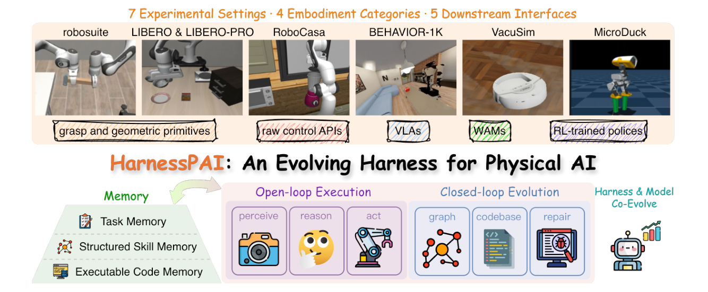

# Related Work
기존 접근은 **적응(adaptation)이 어디에 저장되는가**로 나눌 수 있다.

| 방법 계열 | 적응 위치 | Rollout 중 코딩 에이전트 사용 | API 기반 제어 | 학습된 정책 사용 | Rollout 간 진화 |
| --- | --- | --- | --- | --- | --- |
| VLA/WAM post-training | 모델 파라미터 | ✗ | ✗ | ✓ | 학습 중에만 |
| Code-as-policy | 프로그램 | ✗ | ✓ | ✗ | 가끔 |
| VLA harness | 런타임/메모리 | ✓ | ✓ | ✓ | 보통 |
| **HarnessPAI** | **프로그램/메모리** | **✗** | **✓** | **✓** | **지속적인 진화를 위해 설계** |

> Table 1. VLA는 Vision-Language-Action, WAM은 World Action Model(미래 장면 변화와 행동을 함께 예측하는 모델)

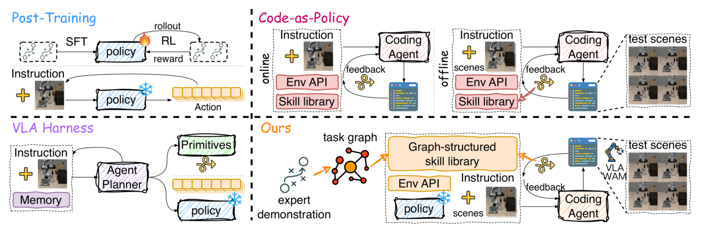

1. **Post-training**: 행동 모델을 SFT나 RL로 학습하고, 추론 때는 고정된 모델이 지시문과 이미지를 받아 행동 청크를 출력한다. 능력은 **학습 중에만** 좋아지고, 파인튜닝은 행동 분포를 좁혀 일반화를 해칠 수 있으며, 성능이 기반 모델과 데이터의 한계를 넘기 어렵다
2. **Code-as-policy**: 사전학습된 모델이 지시문을 인지·기하·동작 API 호출 코드로 바꾼다. 행동을 조합하고 확인하기 쉽지만, 저수준 동작을 손으로 만든 API에 의존하기 때문에 **학습된 정책의 접촉이 많은(contact-rich) 조작 능력을 쓰지 못한다**
   - online: 작업과 시드마다 프로그램을 하나씩 진화시킨다. rollout 하나에 시간과 비용이 크게 든다
   - offline: 몇 개 시드로 프로그램 하나를 진화시키고, 진화 때 보지 못한 새 장면에 그 프로그램을 그대로 실행한다
3. **VLA harness**: 코딩 에이전트가 플래너가 되어, 이미지·지시문·메모리를 보고 기본 동작(primitive)을 호출할지 행동 모델 정책을 호출할지 매 단계 결정한다. API와 학습된 정책을 모두 쓰지만, **rollout 중에도 큰 모델이 계속 추론**해야 해서 부담이 크다
4. **HarnessPAI**: 전문가 시연에서 **과제 그래프**를 만들고, 이 그래프로 코드와 스킬 라이브러리 구조를 정한다. 코딩 에이전트는 플래너로서 **코드를 통해** VLA/WAM 행동을 호출하므로, 코드가 인지·이해·추론·행동 실행을 관리한다. 하나 또는 여러 과제에 대해 여러 환경 시드로 코드를 진화시키고, 프로그램 하나를 처음 보는 여러 테스트 장면에서 평가한다. rollout 중에는 코딩 에이전트를 쓰지 않는다

# Motivation
## Why Do VLA/WAM Models Need a Harness?
최근 VLA/WAM은 대부분 같은 방식으로 만들어진다. VLM이 의미적 인지를 맡고, 따로 학습한 **행동 헤드**(보통 diffusion, flow matching, DiT)가 VLM의 연속 표현을 행동 청크나 잠재 행동으로 바꾼다.
- **π0 계열**: PaliGemma VLM 위에 flow matching 행동 헤드를 학습
- **GR00T N1**: VL 토큰에 조건화된 diffusion transformer 행동 헤드
- **Octo**: Transformer 백본 위의 diffusion 행동 헤드
- **WorldDreamer**: 미래 장면 변화와 행동 청크를 함께 예측하는 WAM
- **RT-2, OpenVLA**: 행동을 VLM의 추가 출력 토큰으로 다룸

구조는 달라도 이 시스템들은 대체로 **행동 중심의 인터페이스**이고, 대부분의 최적화가 행동을 예측하는 데 집중되어 있다. 하지만 행동 과제에서 성능이 높다고 해서 지시나 장면이 바뀌었을 때도 올바른 대상을 찾고 과제를 끝낸다는 보장은 없다.

**성공 사례**: 학습 분포 안의 지시 "접시와 라메킨 **사이에 있는** 검은 그릇을 집어 접시에 놓아라"에서는 π0.5가 올바른 그릇에 접근해서 집고, 옮기고, 놓는다.

**실패 사례 1: 언어 교란**

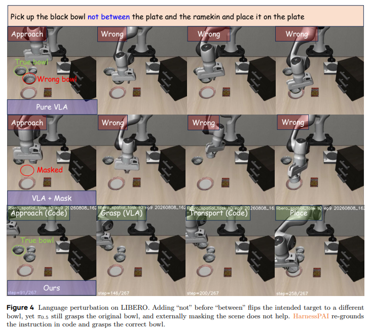

- "between" 앞에 "not"을 붙이면 집어야 할 그릇이 다른 그릇으로 바뀐다. 지시를 이해했다면 대상을 다시 찾아야 하지만, π0.5는 여전히 원래 그릇을 집는다
- 장면을 마스킹해서 보여줘도(VLA + Mask) 해결되지 않는다
- HarnessPAI는 코드에서 지시를 다시 해석해 올바른 그릇을 집는다

**실패 사례 2: 시각 교란**

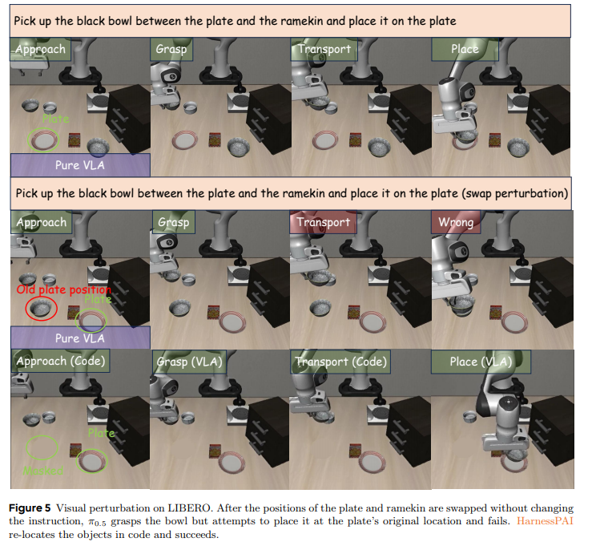

- 지시는 그대로 두고 접시와 라메킨의 위치만 바꾸면, π0.5는 그릇은 집지만 접시의 **원래 위치**에 놓으려다 실패한다
- 표준 LIBERO에서 90% 이상인 모델들이 이런 교란에서 대부분의 정확도를 잃는다는 것이 LIBERO-PRO가 드러낸 문제다
- HarnessPAI는 코드에서 물체 위치를 다시 찾아서 성공한다

**실패 사례 3: 정밀 조작**

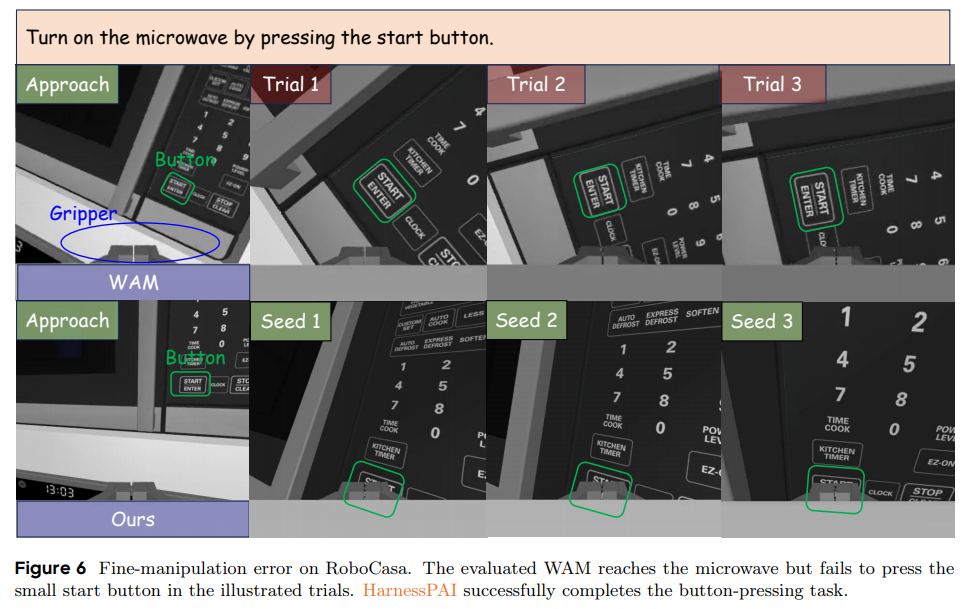

- WAM이 전자레인지까지는 가지만 작은 시작 버튼을 누르지 못한다

이 예시들은 행동 능력만으로는 지시 변화, 장면 교란, 정밀 조작에서 과제를 끝까지 해낸다는 보장이 없음을 보여준다. 그래서 행동 모델은 고정한 채, **명시적인 대상 찾기, 기하 추론, 실행 확인**을 보완하는 외부 하네스를 탐구한다.

> 논문은 이 예시들이 학습 중 시각·언어 능력이 퇴화한 결과인지까지 입증하는 것은 아니라고 조심스럽게 밝힌다.

## Why Open-Loop Execution?
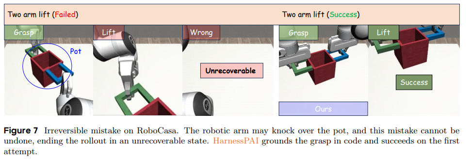

- 물리적 실수는 **되돌릴 수 없는** 경우가 많다. 그림에서 양팔이 잘못된 곳을 잡아 냄비를 넘어뜨리고, 그 뒤로는 복구하지 못해 과제를 완수하지 못한다
- 프로그램 상태를 리셋하고 다시 시도할 수 있는 소프트웨어와 달리, 물리적 행동은 환경에 지속적인 변화를 남긴다
- 그래서 물리 에이전트는 위험한 행동을 실행하기 **전에** 잠재적 오류를 찾아내서, **첫 시도의 성공률**을 높이고 실패 비용을 줄여야 한다

여기서 **open-loop는 프로그램 수준**의 이야기다.
- **Rollout 내부**: 하네스 프로그램은 고정된다. 하지만 실행 중에도 현재 관측과 미리 정의된 검사를 써서 대상을 찾고, 행동을 하고, 다음 단계로 넘어갈지 판단한다. 즉 프로그램 안에서는 관측을 계속 반영하지만, 프로그램 자체를 다시 쓰지는 않는다
- **Rollout 사이**: 실행 피드백으로 프로그램을 수정한다(closed-loop 진화). 이 수정은 리셋이 가능한 실험 환경에서 평가한다
- 두 메커니즘은 서로 보완적이다. rollout 안의 명시적 grounding과 검사는 잘못된 행동의 위험을 줄이고, rollout 간 진화는 다음 실행의 신뢰성을 높인다
- 정리하면, 작업을 수행하기 전에 큰 틀(primitive, VLA/WAM 호출, 조건 검사)을 코드로 미리 짜두고, 그 틀을 rollout 사이에서 계속 고도화하는 방식이다

## Why Use Code as a Physical AI Harness?
코드가 하네스로 적합한 이유는 세 가지다.
1. **실행 가능(executable)**: 프로그램이 과제를 현재 장면에 grounding하고, 단계로 분해하고, 행동 모델을 primitive로 호출하고, 명시적인 성공 검사를 한다
2. **검사 가능(inspectable)**: 인지, grounding, 복구에 관한 결정이 거대한 정책의 가중치 속에 숨어 있지 않고, 읽고 진단하고 고칠 수 있는 구문으로 쓰여 있다
3. **진화 가능(evolvable)**: 피드백에 따라 고친 뒤 다시 실행할 수 있다. 서로 다른 VLA/WAM을 교체 가능한 primitive로 감쌀 수 있고, 학습된 행동 모델이 없으면 직접 API 제어로 축소할 수 있다

**특정 과제에 맞춰 코드를 고쳐나가면 일반화는 어떻게 되나?**

논문은 두 가지 배포 상황을 구분한다.

> 실제 배포에서 에이전트는 **많은 과제를 한 번씩** 하는가, 아니면 **하나의 과제를 여러 번** 하는가?

- 순수 VLA/WAM은 첫 번째 상황, 즉 처음 보는 지시에서도 추론 시점에 올바른 행동을 만드는 것이 목표다
- HarnessPAI는 두 번째 상황, **같은 물리 과제가 반복 실행되는 상황**을 겨냥한다. 다만 반복된다고 각 시도를 대충 해도 되는 것은 아니다. 매번 첫 시도에 성공해야 하고, 반복은 그 사이에 피드백을 모아 프로그램을 다듬을 기회가 될 뿐이다
- 같은 과제 안에서의 일반화: 여러 시드(같은 과제 안에서 물체 배치 등 환경 변수가 다른 경우)로 코드를 진화시키면, 프로그램이 "지시문에 맞는 물체를 찾고, 위치를 계산하고, 검사한다"는 절차로 짜이기 때문에 물체 위치나 배치가 바뀌어도 동작한다. 그래서 장면이나 지시가 교란된 상황에서 성능이 크게 오른다
- 다른 과제로의 일반화: "그릇을 접시에 놓기" 프로그램을 "전자레인지 버튼 누르기"에 그대로 쓸 수는 없다. 과제가 바뀌면 프로그램을 새로 진화시켜야 하지만, 이전 과제에서 모아둔 **수리 스킬**(놓친 뒤 대상 다시 찾기, 누른 뒤 확인하기, 미끄러지면 다시 잡기 등)이 새 과제의 첫 실패에 바로 매칭되어서 처음부터 다시 풀지 않는다

# Framework
## Open-Loop Execution (Rollout 내부)
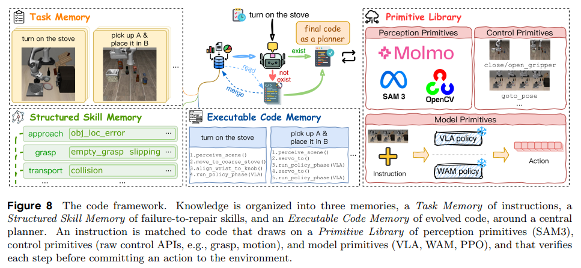

프레임워크는 배운 것을 **세 가지 메모리**에 저장하고, 할 수 있는 것을 **primitive 라이브러리**에 두며, 그 가운데를 코드가 잇는다.

**세 가지 메모리**
1. **Task Memory**: 로봇이 요청받은 과제("가스레인지 켜기", "A를 집어서 B에 넣기" 등)를 저장한다
2. **Executable Code Memory**: 새 과제가 들어오면 Task Memory에서 검색하고, **일치하는 과제가 있으면** 저장된 코드를 바로 실행한다. 이 코드는 코딩 에이전트가 작성한 것이라, 에이전트가 내리는 모든 결정(어떤 물체를, 어디서, 어떻게, 결과가 맞았는지)이 읽고 고칠 수 있는 구문 형태다
3. **Structured Skill Memory**: **일치하는 과제가 없으면** 이 메모리를 활용해서 closed-loop 진화로 들어간다

**Primitive 라이브러리** (세 종류, 서로 교체 가능)
- **인지 primitive**: SAM3 등. 무엇이 어디 있는지 장면을 grounding
- **제어 primitive**: `goto_pose`, `close/open_gripper` 등. 계산한 자세로 이동하거나 그리퍼를 닫는 기하학적 동작
- **모델 primitive**: π0.5 같은 VLA, WorldDreamer 같은 WAM, PPO 정책. 학습된 접촉 조작
- 세 종류 중 어느 것도 특별하지 않다. **행동 모델은 여러 primitive 중 하나일 뿐**이다

기존 과제라면 코드가 플래너 역할을 한다. 인지 primitive로 장면을 파악하고, 기하학적으로 추론하고, 그에 따라 어떤 행동을 할지 정한 뒤에야 행동 모델을 호출한다. 이렇게 해서 인지 모듈이 행동 모델의 약한 인지를 보완하고, 코드가 계획 능력을 높인다.

검증은 될 때까지 반복하는 재시도 루프가 아니라 **성공 검사**다. "그립이 실제로 물체를 잡았는가, 물체가 있어야 할 곳에 있는가"를 확인해야 다음 단계로 넘어간다. 예를 들어 잡기가 확인된 뒤에만 옮기기를 시작한다.

> 논문의 핵심 주장: 피지컬 AI는 행동 모델이 아니라, **실행 가능한 계획으로 묶인 인지 + 기하 + 행동**이며 행동 모델은 그중 교체 가능한 한 부분일 뿐이다.

## Closed-Loop Evolution (Rollout 사이)
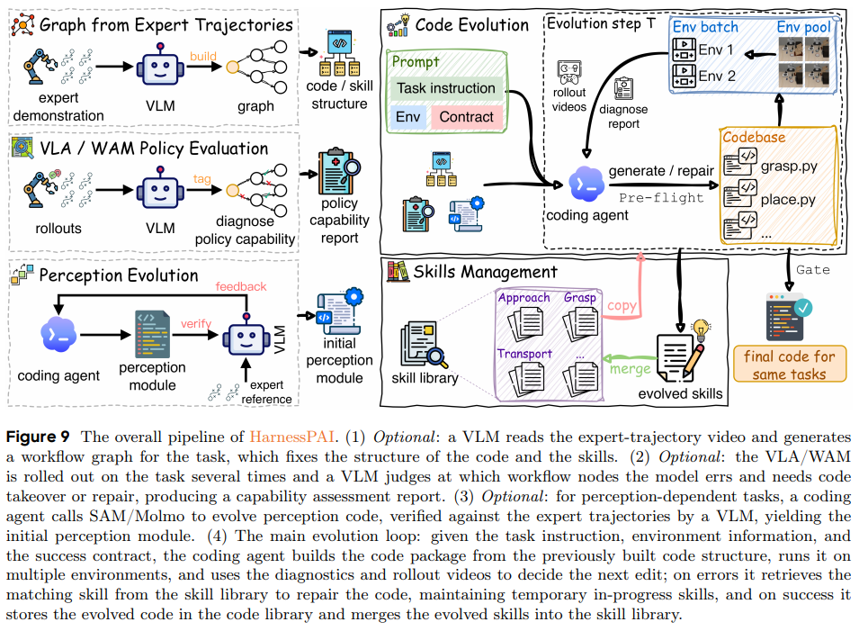

로봇 형태마다 필요한 환경과 시뮬레이션 설정이 크게 달라서, 진화 과정을 **필수 단계 하나 + 선택 단계 셋**으로 나눴다.

**선택 단계** (입력이 있을 때만 켜짐)
1. **워크플로우 그래프 생성**: VLM이 전문가 시연 영상을 보고 과제의 워크플로우 그래프를 만든다. 이 그래프가 코드와 스킬의 구조를 정한다
2. **능력 평가**: VLA/WAM을 해당 과제에서 여러 번 실행하고, VLM이 어느 워크플로우 노드에서 모델이 틀려서 코드가 대신하거나 고쳐야 하는지 판단해 정책 능력 보고서를 만든다
3. **인지 모듈 초기화**: 인지가 중요한 과제에서 코딩 에이전트가 SAM이나 Molmo를 호출해 인지 코드를 진화시키고, VLM이 전문가 시연과 대조해 검증해서 초기 인지 모듈을 만든다
   - 예: LIBERO-Object의 Alphabet soup(캔 모양 물체)은 강한 VLM도 매 프레임 안정적으로 알아보지 못하지만, 전문가 시연을 참고하면 코딩 에이전트가 이 물체를 다른 물체와 구분하는 코드를 작성할 수 있다

**필수 단계: 메인 진화 루프**
- 모든 로봇과 모든 과제가 반드시 거친다
- 과제 지시문, 환경 정보, **성공 계약(success contract)** 이 주어지면, 코딩 에이전트가 이전에 만든 코드 구조 위에 코드 패키지를 작성하고 여러 환경에서 실행한 뒤, 진단 정보와 rollout 영상을 보고 다음 수정을 정한다
- 오류가 나면 스킬 라이브러리에서 맞는 스킬을 검색해서 코드를 고치고, 성공하면 진화된 코드를 코드 라이브러리에 저장하고 새 스킬을 스킬 라이브러리에 병합한다

## Evolution Mechanism
보통 진화는 하나의 과제를 여러 환경 시드로 실행하며 이뤄진다. 실제로도 같은 과제가 반복되지만 환경은 매번 조금씩 바뀌기 때문이다. 개발용 시드로 프로그램을 진화시키고, 벤치마크별로 정한 분할로 평가한다.

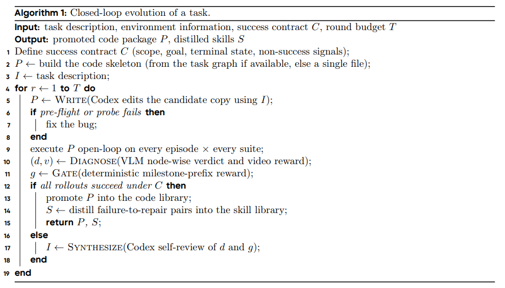

- **입력**: 과제 설명, 환경 정보, 성공 계약 $C$, 라운드 예산 $T$
- **출력**: 승격된 코드 패키지 $P$, 정리된 스킬 $S$

1. **성공 계약 $C$ 정의**: 평가 범위(모든 suite, 모든 에피소드), 목표 조건, 그래프의 종료 상태, 그리고 **그 자체로는 성공이 아닌 신호 목록**(정상 종료, 종료 상태 도달, 높은 dense reward, 작성 모델 스스로의 "수렴했다"는 주장)을 정한다. 이 계약은 매 라운드 작성자, 진단자, 리뷰어 모두에게 주입되어, **무엇이 성공인지를 성공하려는 모델이 정하지 못하게** 한다
2. 과제 그래프가 있으면 그걸로, 없으면 파일 하나로 **코드 골격**을 만든다
3. 매 라운드마다
   - **Write**: 코딩 에이전트(Codex)가 지시 $I$를 보고 후보 복사본을 수정한다
   - **Pre-flight / Probe**: pre-flight는 코드가 돌아가기는 하는지만 확인해서, 환경·드라이버 인터페이스 오류가 정책 실패로 오인되지 않게 한다. probe는 직전 라운드에서 실패한 시드 3개를 골라 고친 뒤 그 3개에서만 다시 검증한다. 통과하면 전체 학습 시드를 다시 돌려 이미 맞던 시드가 깨지지 않았는지 확인한다. 전체 배치를 매번 돌리지 않고도 회귀를 잡는 빠른 피드백 루프다
   - **실행**: 모든 에피소드 × 모든 suite에서 $P$를 open-loop로 실행한다
   - **Diagnose**: VLM(Gemini)이 rollout 영상을 보고 노드별 판정 $d$와 영상 보상 $v$를 만든다
   - **Gate**: **결정론적인 milestone-prefix 보상** $g$를 계산한다. 이 값은 모델을 쓰지 않는 수치 신호라서, 영상 모델이 잘못 판단해도 남는 안전장치다
   - 성공 계약 $C$ 기준으로 **모든 rollout이 성공하면** $P$를 코드 라이브러리에 승격하고, 실패→수리 쌍을 스킬 라이브러리로 정리해서 끝낸다
   - 아니면 **Synthesize**: Codex가 $d$와 $g$를 스스로 검토해서 다음 라운드 지시 $I$를 만든다

**두 모델의 역할 분담**

| 모델 | 역할 | 책임 | 코드 수정 |
| --- | --- | --- | --- |
| GPT-5.6-sol | 작성자 + 종합자 | 단계별 코드 수정, 자기 검토, 다음 지시 작성 | ✓ |
| Gemini-3.5-Flash | 진단자 | rollout 영상을 보고 그래프 노드별로 판정 | ✗ |

> Table 2. 한 모델이 코드를 고치고 그 결과까지 채점하면 자기 시험을 자기가 채점하는 셈이라, 진단은 다른 모델·다른 모달리티(영상)로 분리했다. 최종 성공 판정은 성공 계약과 결정론적 gate가 맡는다.

라운드가 끝나면 진단 영상은 세 가지를 본다. 고쳤어야 할 실패가 재발했는가, 이전에 맞던 시드가 새로 실패하는 회귀가 있는가, 남은 오류의 원인은 무엇인가. 이 답이 다음 라운드의 수정 계획이 된다.

**하이브리드 rollout**

진화가 끝난 코드 패키지는 SAM·Molmo로 장면을 인식하고, NumPy·SciPy·OSC(Operational Space Control)·IK로 기하 추론과 동작 제어를 하며, 정밀 조작은 VLA에 맡긴다.

| 단계 | 실행 주체 |
| --- | --- |
| grounding | 고정 코드 (분할 + 기하) |
| approach | 고정 코드 (Cartesian servo, Pyroki IK 복구) |
| grasp | VLA |
| transport | 고정 코드 |
| place | VLA |

> Table 3. 결정론적인 단계는 고정 코드로, 의미적으로 어려운 단계는 VLA로 실행한다.

작성, pre-flight, rollout은 모두 **격리된 후보 복사본**에서 이뤄지고, 검증된 코드 라이브러리는 후보가 진행 중일 때 건드리지 않는다. 모든 suite에서 전체 에피소드 배치를 통과해야만 한 번에 승격되므로, 검증되지 않은 수정이 저장된 프로그램을 덮어쓰지 않는다.

## Skill Library
Closed-loop가 끝나면 진화된 코드만 남는 것이 아니라, 실패 과정에서 **무엇이 문제였고 어떻게 고쳤는지**에 대한 기록도 함께 남는다. 스킬은 두 부분으로 된 how-to-repair 노트다.
- **문제(problem)**: 어떤 과제 단계에서 어떤 실패를 예상해야 하는가
- **수리(repair)**: 그 실패를 어떻게 넘어가는가

코드 라이브러리는 실행할 계획을, 스킬 라이브러리는 그 계획을 맞게 만든 경험을 저장한다.

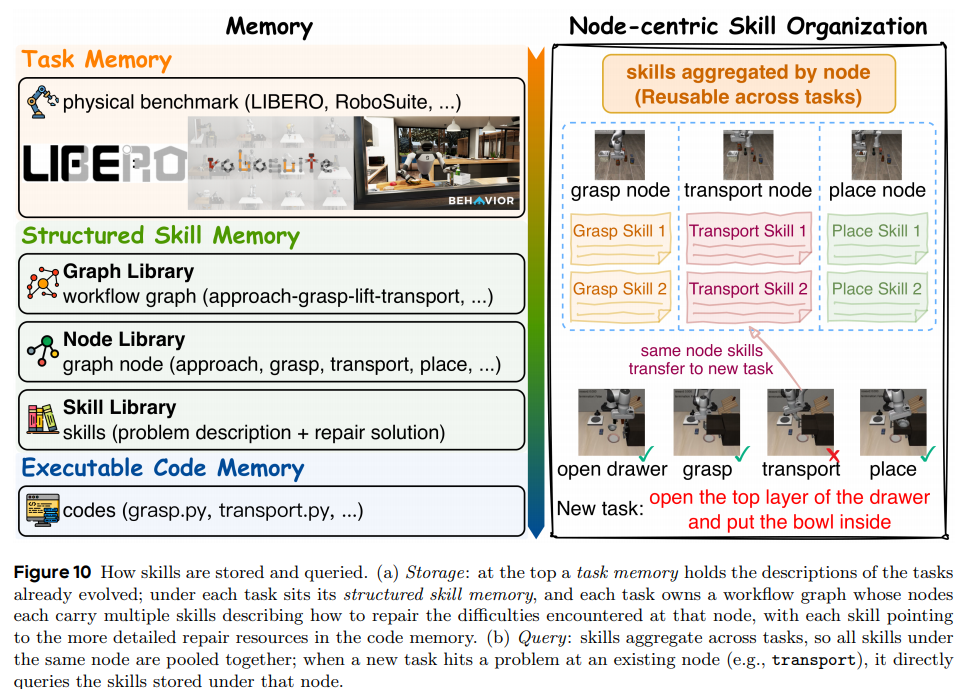

**저장: 과제 그래프에 붙인 4단계 구조**
1. **L1 그래프 라이브러리**: 각 과제의 워크플로우 그래프 (VLM이 생성)
2. **L2 노드**: approach, grasp, transport, place 등
3. **L3 스킬 라이브러리**: 노드마다 그 노드에서 배운 모든 문제-수리 쌍. 같은 단계가 여러 과제에서 반복되고 여러 방식으로 실패하므로, grasp 노드 하나에 미끄러지는 경우, 정렬이 어긋난 경우, 빈손으로 잡은 경우 등 여러 스킬이 쌓인다
4. **L4 코드 라이브러리**: 각 스킬의 수리 방법이 직접 가리키는 실제 수리 코드

스킬 노트에는 설명용 코드 조각이 들어갈 수 있지만, 실제로 유지되는 실행 코드는 코드 라이브러리에 **한 곳에만** 있고 스킬은 "refers to" 링크로 그 코드를 가리킨다. 코딩 에이전트가 스킬을 가져오면 링크를 따라 바로 고쳐야 할 코드로 가므로, 복사된 조각에서 코드를 다시 만들 필요가 없다.

**검색: 노드 단위**
- 새 과제를 통째로 검색하지 않고, 먼저 그 과제의 그래프가 지나갈 노드로 분해한 뒤 **노드를 키로** 스킬을 찾는다
- 즉 스킬은 과제나 이름이 아니라 **실패가 일어난 워크플로우 노드**로 색인된다

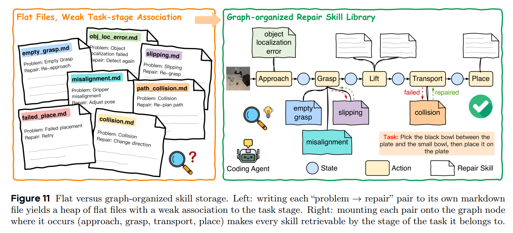

이 구조의 장점은 두 가지다.
1. **찾기 쉽다**: 문제-수리 쌍을 각각 마크다운 파일로 흩어두면(왼쪽) 어느 단계의 실패인지 연결이 약해서 정렬되지 않은 더미에서 찾아야 한다. 노드에 붙여두면(오른쪽) grasp 단계에서 막힌 에이전트는 grasp 노드만 보면 된다
2. **전이된다**: "서랍 열기" 같은 새 과제도 이미 푼 과제와 grasp, transport, place 노드를 공유하므로, 그 노드에 쌓인 스킬이 코드를 한 줄도 쓰기 전에 그대로 전이된다

**스킬 예시** (부록 C): `align-object-to-basket-mouth.md`
- **메타데이터**: 이름, 설명(LIBERO-Object의 place 단계에서 물체를 바구니 입구가 아닌 몸통 기준으로 정렬하는 3D 정렬 문제를 진단·수정), 단계(`place`), 원래 과제
- **발생한 문제**: 바구니 중심을 마스크 전체 점의 XY 중앙값으로 잡다 보니 카메라 쪽 벽이 섞여 목표가 카메라 쪽으로 치우쳤고, 실제로 입구와 5.3cm 어긋났다. 이 문제가 처음에는 운반 중 낙하나 놓기 타이밍 버그로 잘못 진단됐다
- **수리 방법**: 입구(위쪽 테두리) 점만 써서 목표를 잡는 워크플로우, 주의 사항, 그리고 수정할 코드 위치 링크(`grounding.py`의 `basket_center_world` 등)

## Model Feedback
- 메인 진화 루프 동안 행동 모델은 **고정**이다. 그래서 공개된 고정 체크포인트와 공정하게 비교할 수 있지만, 루프는 결국 사용 가능한 primitive의 능력 한계에 묶인다
- 수렴한 하네스의 성공 궤적은 **성공만 걸러진 시연 데이터**다. 특히 LIBERO-PRO의 교란된 과제에는 벤치마크가 제공하는 시연이 아예 없는데, 수렴한 코드는 그 교란 장면에서 성공하는 관측-행동 시퀀스를 스스로 만들어낸다
- 이 궤적으로 VLA/WAM을 **SFT** 해서, 코드의 명시적인 재grounding·복구 행동을 모델 가중치로 증류한다. 같은 궤적과 성공 gate로 RL을 할 수도 있지만, 논문은 더 단순한 오프라인 SFT를 평가한다
- 이득은 **한 방향**이다. 하네스가 데이터를 주고 모델이 배울 뿐, 개선된 모델에 맞춰 하네스를 다시 최적화하지는 않는다

# Experiments
## Experimental Setup
4가지 로봇 형태(단일·양팔 로봇 팔, 이동 베이스 위의 휴머노이드 상체, 로봇 청소기, 보행 로봇)와 7개 벤치마크에서 평가했다. 프레임워크 자체를 검증하기 위해 행동 백엔드도 일부러 다양하게 바꿨다(VLA π0.5, WAM WorldDreamer·DreamZero, grasp 검출기 GraspNet, 순수 제어 API, PPO 정책). 백엔드는 모두 고정 primitive이고 **하네스만 진화**한다. 모든 개발 rollout이 성공 계약을 만족하거나 라운드 예산을 다 쓰면 진화를 멈추고, 성공한 후보만 승격하며, 크래시나 시간 초과는 실패로 센다.

| 벤치마크 | 로봇 | 행동 백엔드 | 진화 / 평가 시드 |
| --- | --- | --- | --- |
| robosuite | 데스크톱 로봇 팔 (단일·양팔) | GraspNet | 시드 101~125로 진화, 1~100으로 평가 |
| LIBERO | 7자유도 Franka 팔 | π0.5-LIBERO | 시드 0~14로 진화, 50개 시드로 평가 |
| LIBERO-PRO | 교란된 LIBERO | π0.5-LIBERO | 시드 0~14로 진화, 50개 레이아웃 시드로 평가 |
| RoboCasa | 이동 매니퓰레이터 | WorldDreamer (WAM) | 고정 레이아웃 장면, 20개 시드 |
| BEHAVIOR-1K | 이동 베이스 위의 가정용 휴머노이드 | GraspNet | 시드 26~35로 진화, 1~25로 제로샷 평가 |
| VacuSim | 로봇 청소기 | 순수 제어 API | 청소 진행률 |
| MicroDuck | 보행 로봇 | PPO Walker 정책 | 횡방향 오차, 목표까지 거리 |

- **robosuite**: 2A-Hand, 2A-Lift, Insert, Lift, Stack, Restack, Wipe 7개 작업
- **LIBERO**: Spatial, Object, Goal 스위트 × 작업 10개. 50개 평가 시드에는 진화에 쓴 15개와 추가 35개가 포함된다(이전 연구와 같은 설정)
- **LIBERO-PRO**: 위 3개 스위트를 **Swap**(두 물체의 초기 위치 교환)과 **Task**(지시 변경) 교란으로 평가, 총 60개 교란 작업. 교란마다 50개 레이아웃 시드로 채점하고 스위트의 10개 작업을 평균낸다. 시드 0~14로 진화한 프로그램 하나를 그대로 50개 시드에 실행한다
- **RoboCasa**: Target50의 Atomic-Seen 설정. 장애물과 방해 물체가 시드마다 바뀐다
- **BEHAVIOR-1K**: 라디오 집기, 탄산음료 캔 집기. 베이스가 목표까지 갈 수 있는지(Nav)와 실제로 집어 올렸는지(Task, end-to-end)를 따로 본다. 적응 버전은 실패한 테스트 시드에서 8라운드 다시 진화한다
- **VacuSim**: 속도 명령과 읽기 전용 센서 피드백만 있는 순수 API로 제어한다. 물리적으로 청소할 수 없는 영역이 있어서 약 80%가 도달 가능한 상한이다
- **MicroDuck**: 직선 걷기 과제. PPO 정책은 앞으로 걷지만 옆으로 벗어나는 것을 벌하지 않아서, 하네스가 횡방향 이탈을 측정해 같은 정책을 조향한다

## Main Results
### robosuite

| Method | 2A-Hand | 2A-Lift | Insert | Lift | Stack | Restack | Wipe | Avg |
| --- | --- | --- | --- | --- | --- | --- | --- | --- |
| CaP-Agent0 | 20 | 74 | 0 | 97 | 98 | 89 | 100 | 68.3 |
| Human | 91 | 94 | 80 | 93 | 73 | 47 | 100 | 82.6 |
| ASPIRE | 92 | 71 | 9 | 97 | 99 | 100 | 99 | 81.0 |
| **HarnessPAI** | **100** | 91 | **83** | **100** | **100** | **100** | **100** | **96.3** |

> Table 6 (부록). 성공률 %. 2A-Hand, 2A-Lift는 양팔 작업

- 평균 **96.3%** 로 가장 강한 하네스 ASPIRE(81.0%)보다 15.3%p, 사람(82.6%)보다 13.7%p 높다
- 7개 중 5개에서 100%이고, 90% 미만은 Insert 하나뿐이다
- 결정적인 차이는 고정 코드가 무너지는 작업에서 나온다. 정밀한 기하 추론이 필요한 **Insert**에서 ASPIRE는 9%, CaP-Agent0은 0%인데 HarnessPAI는 83%로 사람(80%)보다도 높다. 양팔 **2A-Lift**에서도 ASPIRE보다 20%p 높다

### LIBERO

| 계열 | Method | Spatial | Object | Goal | Overall |
| --- | --- | --- | --- | --- | --- |
| Pure model | OpenVLA | 84.7 | 88.4 | 79.2 | 84.1 |
| | CoT-VLA | 87.5 | 91.6 | 87.6 | 88.9 |
| | GR00T N1 | 94.4 | 97.6 | 93.0 | 95.0 |
| | π0.5 | 95.6 | **100.0** | 95.2 | 96.9 |
| | π0 | 96.8 | 98.8 | 95.8 | 97.1 |
| RL-based | π0.5 RLinf | **99.0** | 96.0 | 97.0 | 97.3 |
| | AtomVLA | 96.4 | 99.6 | **97.6** | 97.9 |
| Harness | OpenETA (code-as-policy) | 8.0 | 26.0 | 21.0 | 18.3 |
| | VLA-SCT (OpenVLA) | 91.2 | 92.8 | 82.0 | 88.7 |
| | Harness VLA (π0.5) | 97.0 | **100.0** | 94.0 | 97.0 |
| | **HarnessPAI (π0.5)** | 97.2 | **100.0** | 97.2 | **98.1** |

> Table 4 일부. 논문마다 평가 설정이 완전히 같지는 않다. π0.5, DreamZero, HarnessPAI는 저자들이 직접 평가했다.

- 전체 **98.1%** 로 표에서 가장 높고, 세 스위트 모두에서 상위 2위 안에 드는 유일한 방법이다
- 학습된 행동 모델 없이 코드만 쓰는 OpenETA는 18.3%에 그친다. 코드만으로는 접촉이 많은 정밀 동작을 만들 수 없다는 것을 보여준다
- 같은 π0.5를 쓰는 Harness VLA보다 1.1%p, Goal에서 3.2%p 높다. 다만 평가 프로토콜이 달라서 엄밀한 비교라기보다는 보고된 설정에서의 우위로 해석해야 한다

### LIBERO-PRO

| Method | Object Swap | Object Task | Goal Swap | Goal Task | Spatial Swap | Spatial Task | Avg |
| --- | --- | --- | --- | --- | --- | --- | --- |
| OpenVLA | 0 | 0 | 0 | 0 | 0 | 0 | 0.0 |
| π0 | 0 | 0 | 0 | 0 | 0 | 0 | 0.0 |
| π0.5 | 29.8 | 10.8 | 37.6 | 29.0 | 51.8 | 50.6 | 34.9 |
| CaP-Agent0 | 22 | 18 | 26 | 17 | 12 | 14 | 18.2 |
| ASPIRE | 98 | 95 | 81 | 45 | 51 | 60 | 71.7 |
| Harness VLA (Codex) | 91 | 94 | 66 | 75 | 69 | 81 | 79.3 |
| Harness VLA (CC) | 90 | 88 | 87 | 87 | 80 | 94 | 87.7 |
| **HarnessPAI** | **98.6** | **99.2** | **94.6** | **97.8** | **93.8** | **95.2** | **96.5** |

> Table 7 (부록). 성공률 %

- 표준 LIBERO에서 90%를 넘는 모델들도 교란 앞에서 무너진다. OpenVLA와 π0는 Swap, Task 모두 0%이고, 표준 LIBERO 96.9%인 π0.5도 34.9%로 떨어진다
- HarnessPAI는 **96.5%** 로 ASPIRE보다 24.8%p, Harness VLA(CC)보다 8.8%p 높고, π0.5 대비 **+61.6%p**다
- 같은 프로그램 하나로 원래 과제, Swap, Task를 모두 처리한다. closed-loop 진화가 과제의 틀을 잡는 코드를 고치기 때문에, 고정된 틀을 깨는 교란에서도 표준 LIBERO만큼 복구한다

### RoboCasa

| Method | Type | Atomic-Seen |
| --- | --- | --- |
| π0 | VLA | 34.6 |
| π0.5 | VLA | 39.6 |
| RLDX-1 | VLA | 60.0 |
| WorldDreamer | WAM | 65.0 |
| Harness VLA (Codex) | Harness | 91.6 |
| Harness VLA (CC) | Harness | 79.4 |
| **HarnessPAI (WorldDreamer)** | Harness | **92.2** |

> Table 5. RoboCasa Target50의 Atomic-Seen 부분집합(18개 작업, 성공률 %). 논문마다 설정이 다르다(Harness VLA는 작업당 10개 시드, HarnessPAI는 고정 레이아웃 20개 시드). WorldDreamer와 HarnessPAI는 같은 설정으로 평가했다.

- Omron 이동 베이스를 단 Franka라는 다른 로봇, 다른 행동 모델(WorldDreamer)에서도 효과가 있다
- 자기 기반 정책과 비교하면 WorldDreamer를 감싸서 **65.0% → 92.2%** (+27.2%p)

### BEHAVIOR-1K
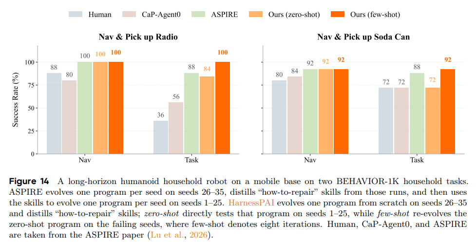

- 이동 베이스 위의 휴머노이드 상체로 두 가정 작업을 수행하며, 이동(Nav)과 end-to-end 완수(Task)를 따로 본다
- **라디오 집기**: 제로샷 프로그램이 이동 100%, 과제 84%로 CaP-Agent0(56%)과 사람(36%)보다 높고 ASPIRE(88%)와 4%p 차이다. 실패한 시드에서 8라운드 다시 진화하면 **100%** 가 된다
- **탄산음료 캔 집기**: 이동 92%, 제로샷 과제 72%이고, 적응 후 **92%** 로 ASPIRE(88%)보다 4%p 높다
- 두 작업 모두 "갈 수는 있는데 끝내지는 못한" 에피소드가 closed-loop 진화로 완전히 사라진다

### VacuSim
학습된 모델이 전혀 없는 환경에서, 범퍼·거리 센서와 ROS 2 제어 API만으로 제한 시간 안에 바닥을 최대한 넓게 청소하는 것이 목표다. 가구가 있는 25×25 아파트(가구 주변 복구가 관건)와 가구 없는 40×40 아파트(효율적인 장거리 커버리지가 관건)로 평가했다.

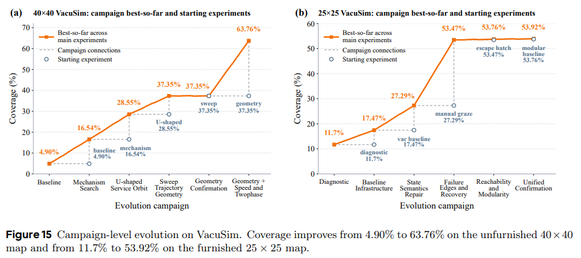

- 청소 범위가 40×40에서 **4.90% → 63.76%**, 25×25에서 **11.7% → 53.92%** 로 오른다
- 진화가 계층적이다. 바깥 라운드마다 기술 방향을 하나 정하고, 그 안에서 측정 가능한 작은 방향들을 격리된 후보 코드로 탐색한다. 방향마다 스킬·코드 메모리를 따로 두고, 개선이 없는 시도가 3번 나오면 그 방향을 접고 다른 방향으로 넘어간다

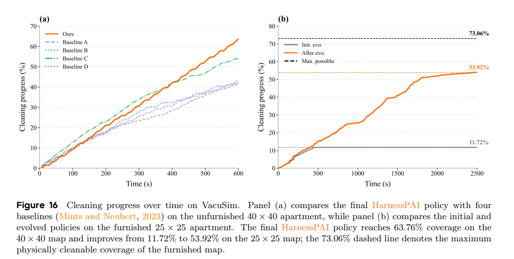

- 40×40에서 최종 정책이 기존 baseline 4개보다 높고, 25×25에서는 물리적 최대치 73.06%에 대해 53.92%까지 오른다
- VLA, 워크플로우 그래프, 인지 단계 없이 메인 진화 루프만으로 동작한 사례이고, 최종 정책은 실행 중에 LLM을 전혀 호출하지 않는다

### MicroDuck
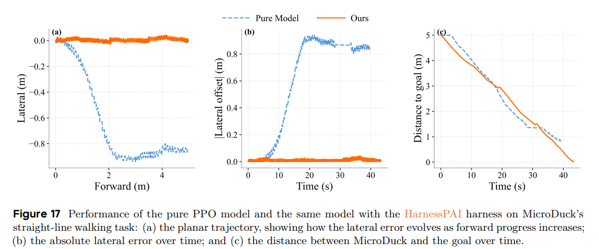

- (a) 평면 궤적: 4m 전진하는 동안 순수 PPO 모델은 최대 0.8m 벗어나지만, HarnessPAI를 쓰면 오차가 0 근처로 유지된다
- (b) 시간에 따른 횡방향 오차: 순수 모델은 오차가 누적되지만 HarnessPAI는 평평하다
- (c) 목표까지 거리: 순수 모델은 이탈 때문에 거리를 좁히지 못하지만 HarnessPAI는 종점에 도달한다
- 개선은 재학습이 아니라 코드에서 나온다. 하네스가 방향 오차를 재서 같은 Walker 정책을 다시 직선으로 조향한다

## Harness Zero-shot
더 엄격한 질문: 진화시킨 하네스가 **재학습 없이 다른 행동 모델로 옮겨가는가?** LIBERO-Object에서 π0.5로 진화시킨 하네스를 고정하고, 행동 모델 호출만 WAM인 **DreamZero**로 바꿔서 LIBERO-PRO로 평가했다.

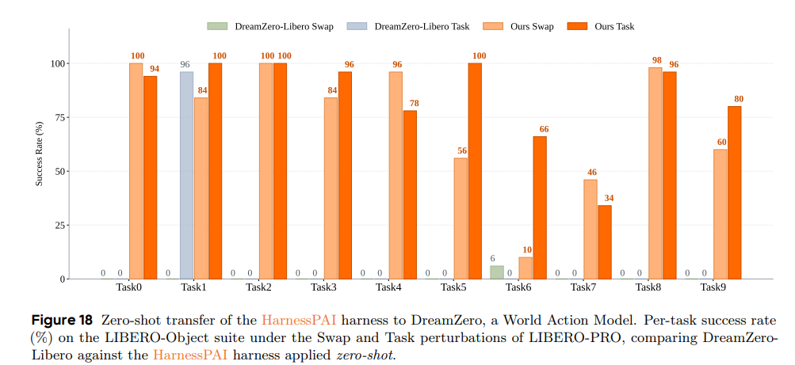

- 원래 DreamZero는 거의 일반화하지 못한다. Swap 0.6%(버터 작업 50번 중 3번 성공이 전부), Task 9.6%(그것도 이미 본 alphabet soup를 알아보고 행동을 재생한 한 작업 덕분)
- π0.5로 진화시킨 하네스를 그대로 씌우면 **Swap 73.4%, Task 84.4%** 로 오른다
- 이득은 행동 모델이 아니라 주변 코드에서 나온다. 인지, 기하 추론, 검증이 학습된 파라미터가 아니라 코드로 쓰여 있어서 새 행동 모델로 그대로 옮겨간다. 같은 하네스로 π0.5에서 얻은 96.5%와의 차이는 더 약한 WAM 탓이다. 논문의 표현으로는 "**코드는 가중치가 일반화하지 못하는 곳에서 일반화한다**"

## Evolution Process
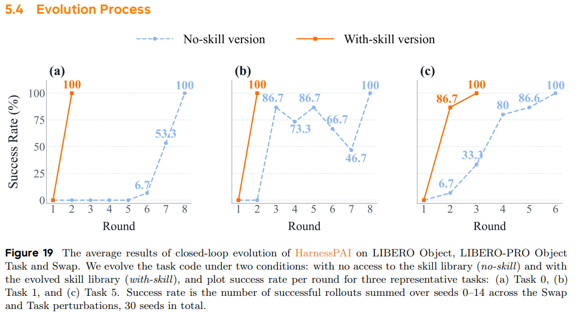

LIBERO-Object 과제 3개를 스킬 라이브러리 **없이(no-skill)** 와 **있이(with-skill)** 진화시키며 라운드별 성공률을 비교했다(시드 0~14 × Swap·Task = 30개).
- 스킬 없이는 세 과제가 서로 다른 경로를 보인다
  - **Task 0 ("Aha" 순간)**: 몇 라운드 동안 0 근처에 머물다가, 막고 있던 오류를 없앤 라운드에 53.3%, 이어서 100%로 뛴다
  - **Task 1 (헤맴)**: 86.7, 73.3, 86.7, 66.7, 46.7%를 오가다가 결국 올바른 프로그램에 도달한다. 탐색 지형이 울퉁불퉁하다는 뜻이다
  - **Task 5 (꾸준한 상승)**: 6.7 → 33.3 → 80 → 86.6%로 부분 수정을 쌓아 100%에 도달한다
- **스킬 라이브러리가 있으면 세 과제 모두 처음 두 라운드 안에 100%** 가 된다. 스킬이 올바른 조작 primitive를 처음부터 제공하므로, 기초 동작을 다시 발견하는 대신 다듬는 데 라운드를 쓴다

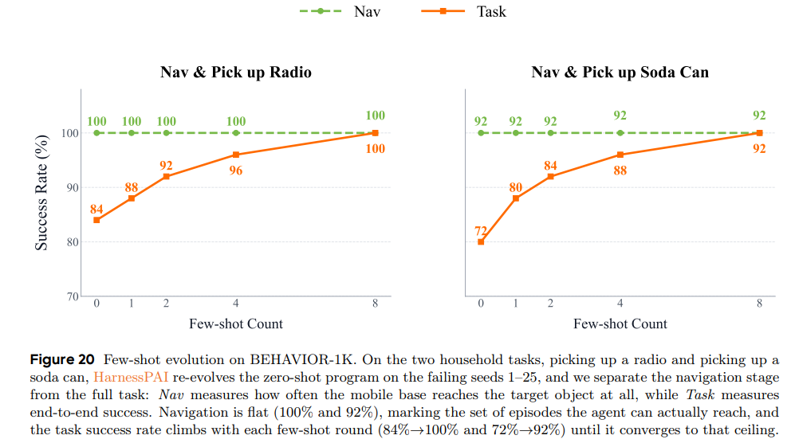

- BEHAVIOR-1K에서 제로샷에 실패한 시드(1~25)로 프로그램을 다시 진화시키면, 이동 성공률은 100%·92%로 그대로이고 과제 성공률이 라운드마다 올라 **라디오 84 → 100%, 캔 72 → 92%** 로 이동 성공률에 수렴한다. 갈 수 있는 에피소드는 모두 끝까지 해낸다

## Cost
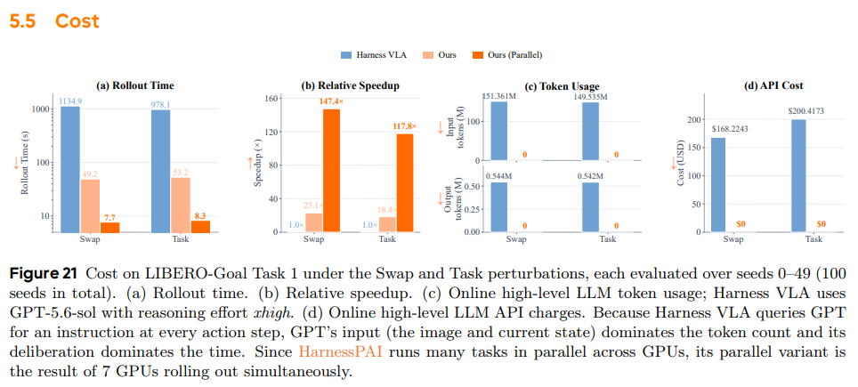

LIBERO-Goal Task 1의 Swap·Task 교란(각 시드 0~49)에서 rollout 비용을 비교했다.

| 항목 | Harness VLA | HarnessPAI (직렬) | HarnessPAI (GPU 7장 병렬) |
| --- | --- | --- | --- |
| Rollout 시간 (Swap / Task) | 1134.9s / 978.1s | 49.2s / 53.2s | 7.7s / 8.3s |
| 속도 향상 (Swap / Task) | 1× | 23.1× / 18.4× | 147.4× / 117.8× |
| 입력 토큰 (50 rollout) | 151.36M / 149.54M | 0 | 0 |
| API 비용 (50 rollout, USD) | 168.22 / 200.42 | 0 | 0 |

- 차이는 구조에서 나온다. Harness VLA는 실행 중 **매 단계** 큰 추론 모델(여기서는 Codex)이 관측과 메모리를 읽고 생각한 뒤 행동을 정해야 해서, rollout이 직렬화되고 매 단계 큰 모델의 지연이 붙는다. 토큰도 대부분 매 단계 넣는 이미지와 상태 입력이다
- HarnessPAI는 과제를 한 번 코드로 컴파일한 뒤 open-loop로 실행하므로, 실행 경로에 상위 LLM 추론이 없다. 그래서 실행 중 LLM 토큰과 API 비용이 0이다
- 단, 이것이 인지·행동 모델 추론·시뮬레이션·하드웨어 비용까지 0이라는 뜻은 아니고, 프로그램을 진화시키는 개발 비용 전체를 비교한 것도 아니다

## Harness Trajectories for Post-Training
수렴한 프로그램을 open-loop로 다시 실행해서 Swap, Task 교란에서 rollout을 모으고, **성공한 궤적만** 걸러 데이터셋을 만든 뒤 π0.5를 SFT했다.
- 수렴한 프로그램은 유료 모델을 호출하지 않으므로, 궤적 하나를 모으는 데 약 1초, API 비용 0원이다. 매 단계 추론하는 하네스는 50 rollout에 168~200달러가 들고, LIBERO-PRO의 교란 과제에는 사람 시연 자체가 없다
- 각 작업에서 시드 0~39를 학습용, 40~49를 테스트용으로 나눴다

**스위트별 학습** (π0.5-LIBERO, 스위트마다 원래·Swap·Task 궤적을 1:1:1로 섞어 학습, 15,000 스텝 중 최고 체크포인트)
- Object **21.5% → 88.0%**, Spatial **50.0% → 82.5%**, Goal **32.5% → 54.5%**

**전체 혼합 학습** (3개 스위트 × 3개 조건, 9가지를 같은 비율로 섞어 학습, 30,000 스텝 중 최고 체크포인트)

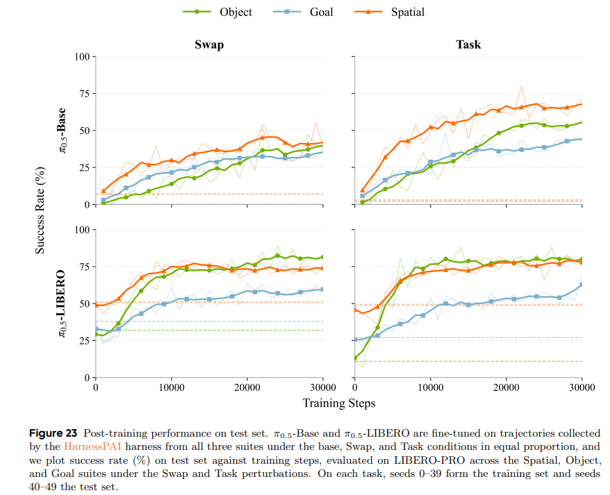

- **π0.5-LIBERO**: LIBERO-PRO 성공률 **34.9% → 73.7%** (+38.8%p)
- **π0.5-Base** (LIBERO로 파인튜닝하지 않은 사전학습 모델): 거의 0 → **53.3%**. LIBERO를 한 번도 본 적 없는 모델이 하네스 데이터만으로 LIBERO-PRO 능력을 얻는다
- 두 체크포인트 모두 세 스위트와 두 교란에서 모두 오른다. 다만 스위트마다 오르는 폭이 달라서, Goal은 Object·Spatial보다 낮게 수렴한다
- 하네스가 고친 내용(인지, 기하, 목표 grounding)에는 일반 behavior cloning이 놓치는 과제 구조가 담겨 있다는 뜻이다. 수렴한 코드가 **값싼 전문가 데이터 수집기**이자 행동 모델을 직접 개선하는 수단이 된다

# Discussion
**왜 동작하는가**
- 순수 VLA는 행동 예측 목표로 학습하면서 VLM의 시각 grounding과 언어 이해가 약해지고, 생성형 행동 헤드는 굵은 동작에는 강하지만 정밀한 미세 변위에는 불안정하다
- 순수 code-as-policy는 반대다. 코드는 grounding, 기하, 검증을 주지만 접촉이 많은 정밀 동작을 명시적인 구문으로 쓰기 어렵다(LIBERO 18.3%)
- HarnessPAI는 둘의 교집합이다. **코드는 VLA가 잃은 시각(V)과 언어(L)를 대신하고, VLA는 코드에 없는 행동(A)을 대신한다**

**언제 동작하는가**
- 만능 수리 도구는 아니다. 행동 모델이 긴 계획을 잇거나 교란 속에서 다시 grounding하지는 못해도, **국소화된 물체를 잡는 것 같은 원자적 능력은 남아 있어야** 한다
- 능력 평가에서 단계를 "잘함 / 코드 필요 / 혼합"으로 나누고, 모델이 약한 곳에만 코드를 쓴다. 모델이 아예 잡지 못한다면 코드로 조직할 능력 자체가 없으므로 도움이 안 된다
- RoboCasa 복합 과제처럼 WorldDreamer가 긴 궤적의 중간을 불투명하게 실행하는 경우에는 코드가 그 내부를 보거나 조향하기 어려워서 이득이 비교적 작다

**전문가 데이터는 어디서 오나**
- 과제 그래프에 필요한 것은 잘 다듬어진 궤적이 아니라 **단계 구조(어떤 단계가 어떤 순서로 있는지)** 뿐이다. 우연히 성공한 영상 하나나 비슷한 과제의 시연으로도 충분하다
- 하네스가 수렴하고 나면 자기 성공 궤적이 행동 모델의 학습 데이터가 되므로, 사람 라벨은 그래프를 그리는 데만 필요하다

# Conclusion & Future Work
- 피지컬 AI가 행동 모델 하나에 치우쳐 있어서 인지, grounding, 계획 능력이 end-to-end 정책 안에서 퇴화한다는 것이 논문의 문제의식이다
- HarnessPAI는 코드를 VLA/WAM의 **대체물이 아니라**, 인지·기하 추론·행동 모델 호출을 묶는 **실행 가능한 하네스**로 쓴다. rollout 안에서는 open-loop로 각 결정을 grounding하고 단계마다 검증하며, rollout 사이에서는 closed-loop로 프로그램을 고치고 실패를 노드 단위 스킬로 정리한다. 수렴하면 그 궤적으로 행동 모델까지 개선한다
- LIBERO 98.1%, LIBERO-PRO 96.5%, RoboCasa 65.0 → 92.2%를 달성했고, 실행 경로에 모델 호출이 없어서 rollout 시점의 이득이 거의 공짜다
- 피지컬 AI의 최전선은 행동 모델뿐 아니라, 그것을 **조직하고 검증하고 진화시키는 실행 시스템**에도 있다

**향후 연구**
1. **행동 모델 인터페이스 표준화**: 지금은 PPO 정책, VLA, WAM마다 입력·출력·지시 방식이 제각각이다. "지시를 주면 원자적 행동 하나를 안정적으로 완수한다"는 하나의 계약으로 통일하면, USB 규격처럼 기기마다 달라도 같은 포트로 꽂히듯 내부를 몰라도 어떤 행동 모델이든 조합할 수 있다
2. **온라인 인지 의존 줄이기**: 지금은 실행 중 매번 SAM, Molmo 같은 인지 단계를 거치는데, 한 번 잘못 인식하면 그 뒤 계산과 행동이 모두 틀어진다. 실행 전에 지도나 3D 장면 모델을 만들어두거나 real-to-sim으로 sim-to-real 격차를 줄이면, 인지를 더 싸고 안정적으로 만들 수 있다
3. **코딩 에이전트와의 결합**: HarnessPAI는 코딩 에이전트를 직접 호출하는 방식의 반대가 아니라 보완이다. 긴 과제를 수행하는 에이전트가 매 단계 생각하는 대신 비슷한 기능의 검증된 코드 패키지를 재사용하거나 조금 고쳐 쓰고, 추론은 정말 새로운 상황에만 쓰게 할 수 있다
